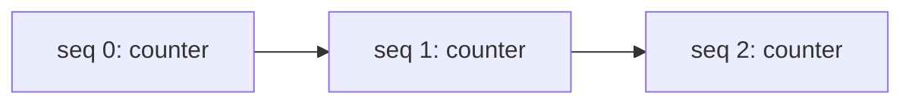

# How to use Causal Replay

**A practical guide to recording, replaying, and branching the history of a Cell graph.**

Causal Replay turns a Cell application from a system that *runs* into a system that can *prove what ran*. You get an append-only, hash‑chained ledger of every state transition, the ability to reconstruct any historical state by re‑executing the pulses that produced it, and the ability to fork the past and test "what if this one input had been different?"

This guide is for developers who want to add replay to a Cell application. It is written to be read linearly the first time, and used as a reference thereafter.

---

## Table of contents

**Part I — Getting started**
1. [What Causal Replay is — and what it is not](#1-what-causal-replay-is--and-what-it-is-not)
2. [Your first replay in 15 minutes](#2-your-first-replay-in-15-minutes)
3. [What just happened: the pieces](#3-what-just-happened-the-pieces)

**Part II — Making a graph replayable**
4. [The seven‑item checklist](#4-the-seven-item-checklist)
5. [Building a replayable graph](#5-building-a-replayable-graph)
6. [The EffectJournal](#6-the-effectjournal)
7. [Purity classification](#7-purity-classification)

**Part III — Recording and replaying**
8. [Binding a ledger and recording](#8-binding-a-ledger-and-recording)
9. [Replaying to a fresh graph](#9-replaying-to-a-fresh-graph)
10. [Reading a divergence report](#10-reading-a-divergence-report)

**Part IV — What‑if branching**
11. [Forking a history](#11-forking-a-history)
12. [Applying a mutation](#12-applying-a-mutation)
13. [Verifying a fork](#13-verifying-a-fork)

**Part V — Governance replay**
14. [Effectful vs. readOnlyExternal TestCells](#14-effectful-vs-readonlyexternal-testcells)
15. [Versioning receptors and mandates](#15-versioning-receptors-and-mandates)

**Part VI — Tooling and operations**
16. [The `cell-replay` CLI](#16-the-cell-replay-cli)
17. [Visualising a ledger](#17-visualising-a-ledger)
18. [Determinism testing in CI](#18-determinism-testing-in-ci)

**Part VII — Reference**
19. [Cheat sheet](#19-cheat-sheet)
20. [Common failure modes and their fixes](#20-common-failure-modes-and-their-fixes)
21. [API reference](#21-api-reference)

---

## 1. What Causal Replay is — and what it is not

### What it is

Causal Replay is a **runtime contract** with three guarantees:

1. **Every mutation is recorded.** A `Ledger` holds an append‑only, hash‑chained entry for every `Cell.apply` and every `ValueCell.update` that occurred inside a `graph.run` scope.
2. **Every non‑deterministic observation is journaled.** An `EffectJournal` records every clock read, UUID, network call, timer firing, and stream event that a receptor or test rule consumed, so the same pulses can be re‑executed without touching the outside world.
3. **Any recorded history can be re‑executed deterministically.** `ReplayEngine.replay` re‑dispatches the recorded pulses into a fresh graph, serves the journaled observations from the ledger, and asserts that the resulting state matches the recording — or **fails loudly** with a `DivergenceReport` that names the offending sequence number.

That third guarantee is what turns a ledger from "a log" into "evidence". A log tells you what was said to happen. A replayable ledger lets you verify that it *did*.

### What it is not

Causal Replay is not a magic "replay anything" tool. The framework is explicit about what it does and does not support, because a tool that silently produces a different state is worse than one that refuses.

| It is *not*… | Because… |
|---|---|
| **Bit‑exact re‑execution of arbitrary user code.** | A receptor that does `DateTime.now()` without journaling is not replayed exactly; it is caught by the determinism check (§18). The framework records *observations*, not *side effects*. |
| **A substitute for a database transaction.** | The ledger guarantees that a *recording* is faithful, not that a *live mutation* is atomic across cells. For multi‑cell atomicity, use `Cell.transaction` (buffer‑and‑commit) or `Cell.txApply` (Saga with compensation). |
| **Cross‑process identity for unregistered cells.** | A `ValueCell` created without `CellGraphBuilder.register` has a process‑local `id`. That's fine for a session; it's not addressable across a restart. Registration (§5) makes the id stable. |
| **Replay across graph shape changes.** | A receptor that was rewired between recording and replay is a **migration**, not a replay. The framework refuses and asks you to record a new ledger at the new shape. |
| **Replay across mandate schema changes without a translator.** | A `DeputyContext` whose schema changed between recording and replay requires a `ContextTranslator` (§15). The framework fails loudly if there is none. |

The rest of this guide is the positive case: how to make a graph *fit* the framework's contract so that these guarantees hold.

---

## 2. Your first replay in 15 minutes

This is the shortest path from "I have a Cell app" to "I have a replayable Cell app". Read it once; if it works, you can skim §3 and jump to §4 for the checklist.

### Step 1 — Build a graph (not a loose cell)

```dart
import 'package:cell/cell.dart';
import 'package:cell/replay.dart';

final counter = Cell.state<int>(initial: 0);

final graph = (CellGraph.builder(graphId: 'my-counter')
      ..registerState('counter', counter))
    .build();
```

`CellGraph.builder` is a builder; `registerState` returns a registered `StateHandle<int>` whose `cell.id` is now `'counter'` — stable across processes. The graph is what Phase 2 calls the **unit of identity**: everything else (ledger, replay, fork) is built on top of it.

### Step 2 — Bind a ledger

```dart
final ledger = await graph.bindLedger(
  store: InMemoryLedgerStore(genesisHash: 'my-counter-genesis'),
);
```

`InMemoryLedgerStore` is fine for a demo. For production, use `FileLedgerStore.open('/var/lib/myapp/ledger.jsonl', genesisHash: '…')` — the file is append‑only and hash‑chained.

### Step 3 — Do some mutations inside `graph.run`

```dart
await graph.run(() async {
  counter.update(1);
  counter.update(2);
  counter.update(3);
});
```

`graph.run` pushes the `LedgerScope` that coordinates state capture and ledger append. **Mutations outside the scope are not recorded.** That's the first rule of replayability: *if it changes state, it goes in `graph.run`.*

### Step 4 — Verify the ledger

```dart
await ledger.verify();
print('Ledger has ${await ledger.lastSeq + 1} entries'); // 3
```

`verify()` walks the hash chain from genesis and returns normally if every entry's hash matches its predecessor's. If anyone has tampered with a byte, it throws `LedgerIntegrityException` with the offending `seq`.

### Step 5 — Replay into a fresh graph

```dart
// Build a fresh graph with the same shape. `forceReset` clears the
// process-wide registry that Phase 2 uses to assign ids — it is safe
// here because this is a fresh graph in the same process.
CellGraphRegistry.forceReset();
final freshCounter = Cell.state<int>(initial: 0);
final freshGraph = (CellGraph.builder(graphId: 'my-counter')
      ..registerState('counter', freshCounter))
    .build();

final result = await ReplayEngine.replay(
  ledger: ledger,
  target: freshGraph,
);

print('Replayed: success=${result.success}, entries=${result.entriesReplayed}');
print('Fresh counter: ${freshCounter.cell.value}'); // 6
assert(result.success);
assert(freshCounter.cell.value == 6);
```

If `success` is `true` and the values match, **you have a working replayable graph**. If it's `false`, `result.divergences` tells you why (§10).

---

## 3. What just happened: the pieces

A replayable Cell app is built from seven types. You don't need to memorise them, but knowing what each one does makes the rest of the guide readable.

| Type | Role |
|---|---|
| **`CellGraph`** | The unit of identity: a set of registered cells with stable `id`s. Its `bindLedger` and `run` methods are the entry points to replay. |
| **`Ledger`** | An append‑only, hash‑chained record of every state transition. Its `verify()` proves the record is intact. |
| **`LedgerEntry`** | One row in the ledger: `seq`, `hash`, `prevHash`, `pulseDigest`, `receipt`, `effects`, `deltas`, `at`. |
| **`EffectJournal`** | The boundary between a receptor and the outside world. Three implementations: `RecordingJournal` (writes), `ReplayJournal` (reads), `NullJournal` (fails loudly). |
| **`EffectRecord`** | One recorded observation: a clock read, a UUID, an I/O call, a stream event, a timer firing, a `TestCell` verdict, or a policy tick. |
| **`ReplayEngine`** | The re‑executor: dispatches recorded pulses through a fresh graph, serving effects from the journal, and produces a `ReplayResult`. |
| **`ForkHandle`** | A forked history: a fresh graph, a fork ledger, and a `ForkRecord` pointing back at the parent. |

The rest of the guide covers each of these in the order they appear in a developer's life cycle: build → classify → record → replay → branch → tool.

---

## 4. The seven‑item checklist

If you read nothing else in this guide, read this. Your graph is replayable if and only if it satisfies all seven items. Each item maps to a specific enforcement in the framework; a violation is either a compile error or a loud runtime failure — never a silent divergence.

| # | Requirement | Enforced by |
|---|---|---|
| **1** | Every cell is registered with a `CellGraph` | `CellGraphBuilder.build` throws on unregistered reachability (§5) |
| **2** | A ledger is bound exactly once | `CellGraph.bindLedger` throws on double bind (§8) |
| **3** | Every mutation is inside `graph.run` | Mutations outside are unrecorded; the replay test (§18) catches them |
| **4** | Every I/O operator is journalled | The five retrofitted operators require `journal:` — missing it is a **compile error** (§6) |
| **5** | Custom receptors/rules declare their purity | Default is `pure`; a rule that does I/O but declares `pure` fails the determinism check (§7) |
| **6** | Receptors whose implementation may change are versioned | `VersionRegistry` dispatch fails loudly on mismatch (§15) |
| **7** | A replay test passes for every graph whose history you intend to keep | Your CI's `ReplayEngine.replay` assertion (§9, §18) |

**The only item that is not mechanically enforced is item 3** — a mutation outside `graph.run` is silently unrecorded, which means a replay of the ledger will miss it. The framework cannot prevent this (the mutation is a legitimate operation; it just isn't recorded), which is why item 7 exists: a replay test is the cheapest way to catch an unregistered‑scope mutation that a code review missed.

---

## 5. Building a replayable graph

### 5.1 The builder is single‑use and strict

```dart
final graph = CellGraph.builder(graphId: 'my-graph', strict: true)
  ..registerState('counter', Cell.state<int>(initial: 0))
  ..register('derived', Cell.derive<Pulse<int>, Pulse<int>>(
    source: registered.cell,
    project: (p) => Pulse<int>((p.payload ?? 0) * 2),
  ))
  .build();
```

`registerState` is the ergonomic path for `ValueCell` handles; `register` is the general path for any `Cell`. The builder:

- Refuses empty or duplicate names (`ArgumentError`).
- Refuses re‑registering the same nucleus under a different name (`ArgumentError`).
- Refuses a name claimed by another builder or graph in the process (`StateError`).
- Rejects the build if a registered root can reach an **unregistered** cell through `bind` or `Synapses` (`StateError`).

That last check is the strictness the plan's exit criterion "unregistered `bind` rejected" describes. It's what makes item 1 of the checklist real.

### 5.2 `strict: false` for tests only

```dart
final testGraph = CellGraph.unrestricted();
```

`unrestricted` returns an **empty** graph with reachability checks disabled. It is used by tests that want to exercise individual mechanics without registering every cell. It is **not** a production mode: a graph built without reachability checks can silently miss a cell, and the ledger will not record that cell's mutations.

### 5.3 Registered cells share identity with their principal

A registered `ValueCell`'s deputy inherits the principal's `id` in the current build (Phase 2 does not give deputies their own ids — see §21, "deputies and ids"). If you need a deputy with a distinct identity for a fork, you must register a *separate* `ValueCell` that watches the principal, not a deputy of it.

### 5.4 `graph.registerVersion` (Phase 7)

Before you record a ledger, stamp your receptors with a version:

```dart
graph.registerVersion('counter');
```

This calls `VersionRegistry.register(cellId, version, receptor, testRule)`. It is a no‑op for cells whose receptor version is `'0.0.0'` (Phase 2's unversioned default), but it becomes load‑bearing in Phase 5: `ReplayEngine` refuses to replay a ledger whose recorded version has no registry entry or matching live implementation. §15 covers this in depth.

---

## 6. The EffectJournal

This is the piece most developers get wrong, so it gets its own section.

### 6.1 What the journal is for

Replay re‑executes pulses. If a pulse's receptor does `await http.get(...)` without journaling, the replay will hit the network again — which is slow, non‑deterministic, and often wrong (the network has changed since recording). The journal is the mechanism that **replaces the network call with the recorded response** during replay.

The contract is simple: any function the framework can call that would observe or mutate the outside world must go through an `EffectJournal`. There are two ways to satisfy the contract:

1. **Use the framework's journalled operators.** `Cell.asyncMap`, `Cell.fromStream`, `Cell.fromFuture`, `Cell.debounce`, and `Cell.throttle` all take a mandatory `journal:` parameter. Their mappers take a mandatory `journal:` parameter. Use them; don't reimplement them.

2. **Route your own effectful code through the journal.** If you write a custom receptor that calls an external service, wrap the call:

   ```dart
   class ProfileFetcher with Effectful {
     final ApiClient api;

     Future<UserProfile> fetch(int id) async {
       return EffectJournal.current.io(
         label: 'fetchProfile($id)',
         input: id,
         run: () => api.fetchProfile(id),
         serializeOutput: (profile) => profile.toJson(),
       );
     }
   }
   ```

   `EffectJournal.current` returns the journal in scope — `RecordingJournal` during recording, `ReplayJournal` during replay, `NullJournal` if there is none. `NullJournal` **throws** on any effect operation. That's the loud failure the checklist item 4 promises.

### 6.2 The `Effectful` and `EffectfulReadOnly` mixins

```dart
class AdminCheck extends TestRule<Cell> with Effectful {
  @override
  Purity get purity => Purity.effectful;   // provided by the mixin
  @override
  String get version => '1.0.0';

  @override
  FutureOr<bool> call(dynamic object, {Cell? host, dynamic arguments}) {
    return EffectJournal.current.io(
      label: 'adminCheck',
      input: object,
      run: () => _isAdmin(object),
    );
  }
}
```

The `Effectful` mixin supplies `purity => Purity.effectful`. It does **not** automatically route effects — the rule body must call `EffectJournal.current.io(...)` (or `.clock()`, `.uuid()`, etc.). The mixin's job is to make the rule's purity *declared*, so that `CellGraph.purityOf` returns `effectful` and `ReplayEngine` in Phase 5 knows to serve the verdict from the journal instead of re‑calling the rule (§14).

`EffectfulReadOnly` is the same, but its purity is `readOnlyExternal`. Use it for rules that *read* the outside world (a config value, a clock check, a read‑only DB lookup) but do not mutate it. The distinction matters at replay time: `readOnlyExternal` rules are re‑called and their reads are served from the journal; `effectful` rules are **not** re‑called — their recorded verdict is served directly.

### 6.3 The five journalled operators

Every one of these now requires a `journal:` parameter:

| Operator | Signature |
|---|---|
| `Cell.asyncMap<S, T>` | `(source, Future<T> Function(S, {required EffectJournal journal}) mapper, {required EffectJournal journal, …})` |
| `Cell.fromStream<T>` | `(Stream<T> stream, {required EffectJournal journal, …})` |
| `Cell.fromFuture<T>` | `(Future<T> future, {required EffectJournal journal})` |
| `Cell.debounce` | `(source, Duration, {required EffectJournal journal, …})` |
| `Cell.throttle` | `(source, Duration, {required EffectJournal journal, …})` |

A caller that forgets `journal:` **fails to compile**. This is intentional: the compile error is the fastest, cheapest, most reliable way to enforce the checklist.

For `debounce` and `throttle`, the journal records the timer's scheduled duration and its actual fire time. During replay, the timer callback fires immediately (in journal order), reproducing the interleaving without waiting real time. That is why a `debounce` cell is replayable at all — without the journal, the wall‑clock dependency would make replay non‑deterministic.

### 6.4 `JournalScope` — the ambient

You rarely touch `JournalScope` directly. It is pushed by:

- `graph.run` (via `LedgerScope`, see §8)
- every journalled operator's entry point
- `ReplayEngine._replayOne` (during replay)

Inside a scope, `EffectJournal.current` returns the journal. Outside, it returns `NullJournal.instance`, which throws on any operation. The correct response to a `NullJournal` error is *not* to catch it — it is to wrap the calling code in `graph.run` (during recording) or to pass the journal explicitly (during replay).

---

## 7. Purity classification

Every receptor and every test rule has a `Purity`:

| Purity | Meaning | What replay does |
|---|---|---|
| `pure` | Output is a function of inputs alone | Re‑executes the rule; no journal needed |
| `readOnlyExternal` | Reads the outside world, doesn't mutate it | Re‑executes the rule; its reads are served from the journal |
| `effectful` | Mutates the outside world | **Does not re‑execute** the rule; serves its recorded verdict from the journal |

The default for both `Receptor` and `TestRule` is `pure`. Override it if your code isn't pure.

```dart
// Pure (default) — no override needed
class Double extends TestRule<Cell> {
  @override
  FutureOr<bool> call(dynamic object, {Cell? host, dynamic arguments}) =>
      (object as int).isEven;
}

// readOnlyExternal — reads the clock, doesn't mutate
class NotExpired extends TestRule<Cell> with EffectfulReadOnly {
  final Duration ttl;
  final Map<String, DateTime> issued;
  NotExpired(this.ttl, this.issued)
      : super((_, {host, arguments, user}) => false);

  @override
  FutureOr<bool> call(dynamic object, {Cell? host, dynamic arguments}) {
    final issuedAt = issued[object];
    final now = EffectJournal.current.clock();
    return issuedAt != null && now.difference(issuedAt) < ttl;
  }
}

// effectful — mutates the outside world
class RecordAudit extends TestRule<Cell> with Effectful {
  @override
  FutureOr<bool> call(dynamic object, {Cell? host, dynamic arguments}) {
    return EffectJournal.current.io(
      label: 'audit',
      input: object,
      run: () async {
        await auditLog.write(object);
        return true;
      },
    );
  }
}
```

`CellGraph.purityOf('cellName')` returns the *weaker* (more external) of the receptor's purity and the rule's purity. A cell with a pure receptor and an effectful rule is effectful. This is what Phase 5 consults when it decides whether a cell requires a journal on replay.

---

## 8. Binding a ledger and recording

### 8.1 Binding

```dart
final ledger = await graph.bindLedger(
  store: FileLedgerStore.open('/var/lib/myapp/ledger.jsonl',
      genesisHash: 'my-app-2025-11-13'),
);
```

- **One ledger per graph.** Binding twice throws `StateError`. This is item 2 of the checklist.
- **The genesis hash** is the seed of the hash chain. It must be stable across restarts; if you regenerate it, an existing ledger's genesis will not match and `verify()` will fail. Use a versioned constant.
- **`bindLedger` calls `Ledger.openVerified`**, which runs `verify()` before returning. A corrupt store fails at bind time, not on first append.

### 8.2 Recording

```dart
await graph.run(() async {
  counter.update(1);
  counter.update(2);
  await someAsyncOperation();
  counter.update(3);
});
```

Everything inside `graph.run` is recorded. The `LedgerScope` is pushed for the duration of the closure and popped on exit (success or error). Each `Cell.apply` and each `ValueCell.update` inside the scope produces exactly one `LedgerEntry`.

Two rules of thumb:

1. **Mutations inside `graph.run`, not outside.** If you have a code path that isn't replayable (a UI animation, a debug‑only mutation), that's fine — just don't expect it in the replay.
2. **Effects inside the journal, not beside it.** `EffectJournal.current.io(...)` is the contract; a bare `await http.get(...)` inside `graph.run` will be **recorded as part of the pulse** but its output will be re‑executed during replay, which is exactly the divergence the framework refuses to hide.

### 8.3 The ledger entry

Every entry has these fields:

| Field | Meaning |
|---|---|
| `seq` | Monotonic sequence, starting at 0 |
| `hash` | `H(prevHash, seq, pulseDigest, receiptDigest, effectsDigest, deltaDigest, at)` |
| `prevHash` | The previous entry's `hash` (genesis hash for `seq == 0`) |
| `pulseDigest` | SHA‑256 of the canonical JSON of the pulse |
| `receipt` | The `ApplyReceipt` (id, cell, function, arguments, vetted, versions) |
| `effects` | The `EffectRecord`s consumed during this pulse |
| `deltas` | The `StateDelta`s: `(cellId, before, after, at)` |
| `at` | Wall‑clock time of the commit |

Two properties matter at replay time: `pulseDigest` (used to reconstruct and verify the pulse), and `deltas` (used to verify the state after replay). Everything else is provenance.

---

## 9. Replaying to a fresh graph

### 9.1 Building a fresh target

The target is a graph with **the same shape** as the recording. It must not be bound to a ledger (Phase 5's `ReplayEngine.replay` throws if `target.ledger != null`).

```dart
CellGraphRegistry.forceReset();    // clear process-wide ids from the recording graph
final freshCounter = Cell.state<int>(initial: 0);
final freshGraph = (CellGraph.builder(graphId: 'my-counter')
      ..registerState('counter', freshCounter))
    .build();
```

`CellGraphRegistry.forceReset()` is required when the recording graph and the replay graph share a process, because both want the same `id` (`'counter'`) and the process‑wide registry refuses to register two nuclei under one id. In production, the recording process and the replay process are usually separate, and no reset is needed.

### 9.2 Running the replay

```dart
final result = await ReplayEngine.replay(
  ledger: ledger,
  target: freshGraph,
);
```

The engine:

1. Iterates entries from `fromSeq` (default 0) onward.
2. Verifies each entry's `receipt.ledgerSeq` and `receipt.pulseDigest` against the entry (unless `options.verifyReceipts: false`).
3. Resolves the target cell by `receipt.cell.id`. An unregistered cell is a divergence.
4. Reconstructs the input pulse from `receipt.arguments` (apply path) or `delta.before` (emit path).
5. Pushes a `ReplayJournal` for the entry, reseeds the cycle checker if requested, and dispatches the pulse through the target cell.
6. Asserts the journal is fully consumed (no missing effects, no extra effects).
7. Compares the resulting cell value to `delta.after`.

A failure at any step produces a `DivergenceReport`; `ReplayOptions.failOnDivergence` (default `true`) throws `ReplayDivergenceException` on the first one.

### 9.3 The result

```dart
class ReplayResult {
  final bool success;
  final int entriesReplayed;
  final int? divergedAt;               // seq of the first divergence
  final List<DivergenceReport> divergences;
  final CellGraphSnapshot newSnapshot; // state at end of replay
}
```

`newSnapshot` is the target graph's state *after* replay completes. On success, it matches the ledger's recorded state; on failure (in lenient mode), it reflects the modified graph.

### 9.4 Lenient replay for diagnostics

```dart
final result = await ReplayEngine.replay(
  ledger: ledger,
  target: freshGraph,
  options: ReplayOptions.diff,        // failOnDivergence: false
);
for (final d in result.divergences) {
  print('seq ${d.seq}: ${d.reason}');
}
```

`ReplayOptions.diff` continues past the first divergence and collects all of them. That is what the CLI's `replay diff` uses (§16). Note that once a divergence occurs, **subsequent entries will also diverge** — they see a state that is not the state the recording had. For a full diff of *all* divergences, you'd need snapshot reconstruction at each entry, which is Phase 5.1 and not shipped in Phase 8.

---

## 10. Reading a divergence report

The most useful thing about replay is not when it succeeds; it is what it tells you when it fails. A `DivergenceReport` is structured to answer three questions:

| Field | Answers |
|---|---|
| `seq` | **Which entry diverged.** Use this to `grep 'seq: 47' ledger.jsonl` and see exactly what was recorded. |
| `expected` / `actual` | **What the difference is.** For a delta mismatch: `after` values. For a journal mismatch: expected vs actual effect fingerprints. |
| `lastEffect` | **What the replay consumed last before diverging.** This is what tells you "the receptor reached the network call at ordinal 5, then diverged." |
| `reason` | A human‑readable explanation. |

### Example: a receptor that changed

```
DivergenceReport(
  seq: 47,
  reason: delta.after mismatch for cell "counter" (the receptor produced a different value than recorded),
  expected: 48,
  actual: 49,
)
```

This means: at entry 47, the recording saw `counter` change to 48, but the replay saw 49. The receptor changed (the framework cannot know *how*; that's a code‑review question). To fix:

1. **Fix the receptor back to its recorded behaviour.** Then replay succeeds.
2. **Register the old receptor as a version** and stamp the new one. §15 covers version dispatch.

### Example: an effect mismatch

```
DivergenceReport(
  seq: 12,
  reason: journal divergence: I/O label mismatch: expected "fetch(3)", recorded "fetchV2(3)",
  lastEffect: IoEffect(ordinal: 4, label: "fetchV2(3)", ...)
)
```

This means: at entry 12, the replay reached an `IoEffect` with the *new* label `"fetchV2(3)"`, but the ledger recorded `"fetch(3)"`. The receptor's I/O call was renamed since recording. The `lastEffect.ordinal == 4` tells you the divergence happened on the fifth effect of that pulse (0‑indexed) — useful when the receptor has multiple calls and you want to pinpoint which one changed.

### Example: a missing effect

```
DivergenceReport(
  seq: 8,
  reason: journal not exhausted: 1 unused effect(s),
  expected: journal exhausted,
  actual: 1 unused effect(s),
)
```

This means: the replay's receptor performed *fewer* effects than the recording did. The receptor was simplified (a call was removed) or a conditional branch now takes a different path. To resolve, either restore the removed effect or record a new ledger at the current receptor.

---

## 11. Forking a history

A fork is a **branch of a history**: it starts at a specific sequence number in a parent ledger, takes a fresh graph as its working state, and records its own history going forward. The fork's genesis is a `ForkRecord` that points back at the parent, so an auditor can verify both.

### 11.1 Creating a fork

```dart
final fork = await graph.fork(
  parent: ledger,
  atSeq: 100,
  buildFreshGraph: () {
    CellGraphRegistry.forceReset();
    final fresh = Cell.state<int>(initial: 0);
    return (CellGraph.builder(graphId: 'my-counter')
          ..registerState('counter', fresh))
        .build();
  },
  store: InMemoryLedgerStore(genesisHash: 'fork-genesis'),
);
```

- **`parent`** is the parent `Ledger`. `fork` verifies it before forking — a fork of a corrupt ledger is a fork of a lie.
- **`atSeq`** is the parent's sequence number at which the fork starts. The fork's `ForkRecord.divergedAt` is this value; the fork replays from `atSeq + 1`.
- **`buildFreshGraph`** is a factory that builds a graph with the same shape. The fork does not clone the parent's graph — it builds a fresh one, which is what makes the isolated policy fast and safe.
- **`store`** is the fork's ledger store. It gets its own file or memory region.

### 11.2 What the fork contains

```dart
print(fork.record.forkId);              // UUID
print(fork.record.originalLedgerId);    // the parent graph's id
print(fork.record.divergedAt);          // 100
print(fork.record.parentHeadHash);      // the parent's hash at seq 100
print(fork.record.originalSnapshotHash); // the parent's snapshot hash at seq 100
print(await fork.ledger.lastSeq);       // 0 — only the ForkRecord so far
```

The fork's ledger has exactly one entry (`seq 0`, the `ForkRecord`) until you replay into it. That is what makes "fork at 100" mean "the fork's baseline is the parent's state at 100; the fork replays 101 onward."

### 11.3 Fork policies

Phase 6 ships **only `ForkPolicy.isolated`** — a fresh graph and a fresh ledger. The other two (`sharedTopology`, `dropUnreached`) are Phase 6.1 and throw `UnimplementedError`. The isolated policy is correct for every case; it costs a graph rebuild, which is fast.

---

## 12. Applying a mutation

A mutation is a function `(LedgerEntry, Pulse) -> Pulse?`:

- Return `null` → **drop** the entry. The fork replays without it.
- Return the same pulse → **pass through** unchanged.
- Return a different pulse → **replace** it.

```dart
final result = await ReplayEngine.replayFork(
  fork: fork,
  mutation: (entry, pulse) {
    if (entry.seq == 150) {
      // What if the user had entered +1000 instead of +150?
      return Pulse<int>(1000, source: pulse.source);
    }
    return pulse;
  },
);
```

The fork's graph, after replay, reflects the mutated history. `fork.ledger` now has one entry per replayed pulse (whether original, replaced, or — for dropped entries — omitted). Each entry is a genuine `LedgerEntry` with its own effects and deltas, so the fork's `verify()` works the same as a recording's.

### What mutation cannot do

- **Inject a pulse that has no parent entry.** A what‑if that says "what if we *also* sent command X at seq 150" needs a `(pulse, receipt)` pair with no ledger entry to reconstruct from. The caller can compose this manually: replay to seq 150, call `apply` on the fork's graph with the new pulse, continue the fork's replay from 151. Phase 6 does not fold this into `Mutation`.
- **Modify a `TestCell`'s verdict.** A mutation that replaces the pulse still goes through the fork graph's test rule. If the rule rejects the mutated pulse, the fork records a delta with no change. If you want a speculative fork where the rule is bypassed, that is a Phase 6.1 `ForkPolicy.speculative` variant, not the default.
- **Preserve the parent's effects.** The fork records *its own* effects during replay. A mutation that replaces a pulse produces new effects (recorded during the fork); a mutation that passes through produces the same effects (re‑recorded, because the fork's ledger is independent).

---

## 13. Verifying a fork

A fork's `verify()` requires the **parent's `verify()` to pass**. That is the whole point: a fork is only as trustworthy as the history it branches from.

```dart
await fork.verify();
```

`ForkVerify.verify` runs three checks:

1. **Parent verification:** `await parent.verify()`. A tampered parent fails the fork.
2. **Fork chain verification:** `await ledger.verify()`. The fork's own chain must be intact.
3. **Genesis binding verification:** the fork's `ForkRecord.parentHeadHash` must match the parent ledger's hash at `divergedAt`. A fork whose `parentHeadHash` does not match the parent's actual hash is either stale or forged.

If any check fails, `ForkIntegrityException` is thrown with the `forkId` and the reason. The exception is deliberately loud — a fork that fails verification is not a fork, and continuing to use it produces state that no ledger explains.

### Auditing a fork

An auditor receiving a fork ledger and its parent ledger:

1. `parent.verify()` — parent intact?
2. `fork.verify()` — fork intact and bound to the parent?
3. `fork.record.divergedAt`, `fork.record.forkId`, `fork.record.originalSnapshotHash` — recorded where and when, from which state.
4. `fork.ledger.entriesSince(0)` — what happened from the fork point onward.

That is the full audit. No trust in either operator's self‑reported state is required — only the arithmetic of the hash chain.

---

## 14. Effectful vs. readOnlyExternal TestCells

§7 introduced the purity classification. Here is how it behaves at replay time, which is the part that matters for a `TestCell`.

### Pure rules

Re‑executed. The rule's decision is a function of its input; replay re‑computes it exactly. Nothing to record.

### `readOnlyExternal` rules

Re‑called, with their reads served from the journal. A rule like `NotExpired` that consults `EffectJournal.current.clock()` will, during replay, receive the same clock value the recording received, so its decision is the same.

This is the *cheap* mode: one journaled read per invocation, no verdict record. Use it whenever your rule's non‑purity is a *read*.

### `effectful` rules

**Not re‑called.** The recorded verdict is served from the journal.

This is the *expensive* mode: one `VerdictEffect` per invocation, recorded at the point the rule fires. Use it whenever your rule performs a *write* (an audit log entry, a notification) — because re‑calling the rule would re‑do the write, which is exactly what replay is supposed to prevent.

The mechanism is `TestCellReplay.invoke`:

```dart
switch (rule.purity) {
  case Purity.pure:
    return await rule.call(object, host: host);
  case Purity.readOnlyExternal:
    return await rule.call(object, host: host);  // reads go through journal
  case Purity.effectful:
    return await EffectJournal.current.verdict(
      ruleLabel: '${rule.runtimeType}@${rule.version}',
      input: object,
      run: () => rule.call(object, host: host),
    );
}
```

On the recording side, `ReplayJournal.verdict` runs the closure (which calls the rule and, inside it, performs the effect). On the replay side, `ReplayJournal.verdict` serves the recorded verdict — the closure is **not called**, so the rule's effect is not re‑performed.

`TestCellReplay.invoke` is wired into `ReceptorBase._proceed` for the pulse path. The `apply` path (where `TestActionRule` fires) is a Phase 7.1 concern — see §21.

---

## 15. Versioning receptors and mandates

The version story has two halves: receptors (code) and mandates (contexts). Both are covered by the framework's version dispatch.

### 15.1 Receptor versions

Every `Receptor` and `TestRule` has a `version` string, defaulting to `'0.0.0'` (unversioned). Set it when your implementation might change:

```dart
class CounterIncrementReceptor extends ReceptorBase<ValueCell<int>> {
  @override
  String get version => '1.0.0';
  // ...
}
```

The ledger records the receptor version in the receipt. During replay, `ReplayEngine._checkVersions` runs before dispatch:

1. If the ledger has no version info (pre‑Phase 7 ledger), and the live receptor is unversioned, replay proceeds. Otherwise it fails loudly — refusing to guess.
2. If the ledger's version is registered in `graph.versions` (via `graph.registerVersion('counter')`), it dispatches to the registered implementation.
3. If the ledger's version matches the live receptor's version, it dispatches to the live implementation.
4. Otherwise, it fails with a `DivergenceReport` explaining the version boundary.

**Item 6 of the checklist is item 6 for a reason.** An unversioned receptor whose implementation changes produces a ledger that cannot be replayed. A versioned receptor produces a ledger that fails loudly when the version changes — which is what you want, because it forces you to *decide* whether the change was a refactor (register the old version) or a real change (record a new ledger).

### 15.2 Mandate versions

`DeputyContext` has a `version` field (default `'1.0.0'`). It is a **static pillar** — you cannot evolve a context's version; you can only create a new one at a different version.

If your mandate schema changes (a field is added, renamed, or removed), the recording's ledger will have old‑version contexts and the replay's graph will have new‑version contexts. `ReplayEngine` refuses this unless a `ContextTranslator` bridges the two:

```dart
class V1ToV2Translator extends ContextTranslator {
  @override
  String get fromVersion => '1.0.0';
  @override
  String get toVersion => '2.0.0';

  @override
  FutureOr<DeputyContext> translate(DeputyContext source) {
    return DeputyContext(
      baseContext: source,
      authority: source._resolvedAuthority() ?? 'UNKNOWN',
      role: source.role,
      clearance: source.clearance,
      version: '2.0.0',
      // new fields added in v2
    );
  }
}

graph.translators.register(V1ToV2Translator());
```

The translator's contract is **directional** (`v1 → v2` is not the same as `v2 → v1`) and **semantic** (a `Clearance.administrative` context must not silently become `observational`). The framework cannot know what your schema means; the translator is the hook where you say it.

If there is no translator for a version boundary, `ReplayEngine` throws `UnimplementedError` with a message naming the required pair. That is item 7 of the checklist: `VersionRegistry` + `ContextTranslatorRegistry` must be set up before replay across a schema boundary.

---

## 16. The `cell-replay` CLI

The CLI turns a ledger file into evidence you can inspect without writing code.

### 16.1 `verify`

```bash
cell-replay verify --ledger /var/lib/myapp/ledger.jsonl
```

Exit code 0 on a valid chain, 1 on a tampered ledger with a formatted report, 2 on usage error.

```bash
cell-replay verify --ledger ledger.jsonl --format json
```

Emits canonical JSON of `{status: "ok", lastSeq: N}` or `{status: "invalid", seq, reason}`. Use this in CI: the exit code is authoritative, the JSON is diagnostic.

### 16.2 `diff`

```bash
cell-replay diff --ledgerA a.jsonl --ledgerB b.jsonl
```

Compares two ledgers entry by entry and reports the first hash mismatch, `only in A`, or `only in B` per sequence. Exit code 1 if they differ, 0 if identical.

Use this to compare a recording against its replay's ledger, or to compare two forks of the same history.

### 16.3 `fork`

```bash
cell-replay fork --ledger ledger.jsonl --at 100 --out fork.jsonl
```

Creates a fork ledger whose `seq 0` is a `ForkRecord` pointing at `ledger.jsonl`'s seq 100. The output is a valid fork that can be verified against the parent.

**Phase 8 limitation:** `--replaceSeq` (mutation on fork) is Phase 8.1; the CLI cannot reconstruct a target graph. Use `ReplayEngine.replayFork` from code when you need to mutate.

### 16.4 `inspect`

```bash
cell-replay inspect --ledger ledger.jsonl
```

```
Ledger summary
  entries:       200
  deltas:        200 across 1 cell(s)
  cells:         counter
  span:          42 ms
  first entry:   2025-11-13T10:00:00.000Z
  last entry:    2025-11-13T10:00:00.042Z
```

The fastest way to sanity‑check a ledger: does it have the number of entries you expect, touching the cells you expect, over the time span you expect?

---

## 17. Visualising a ledger

`CellGraph.visualise()` and `Ledger.visualise()` (or `cell-replay visualise`) produce mermaid or DOT graphs.

### 17.1 The two modes

**`--mode deltas`** (default) — the forensic view. Nodes are deltas; edges are pulse order.



**`--mode cells`** — the topology view. Nodes are cells; useful for "which cells participated in this history".

### 17.2 From the API

```dart
print(graph.visualise(format: 'mermaid'));
print(await ledger.visualise(format: 'dot', mode: 'deltas'));
```

Both return strings. Paste them into a markdown file (mermaid renders on GitHub) or feed them to `dot` (DOT renders locally).

For an audit, `--mode deltas` is the right starting point: it shows the causal chain in order, which is the first question ("what happened?") followed by a cross‑reference against `cells` ("who could have made it happen?").

---

## 18. Determinism testing in CI

A replay test is the single most valuable thing you can do for a replayable graph. It catches every checklist item at once.

### 18.1 Your basic replay test

```dart
test('graph history replays deterministically', () async {
  // 1. Record.
  final counter = Cell.state<int>(initial: 0);
  final graph = (CellGraph.builder(graphId: 'test')
        ..registerState('counter', counter))
      .build();
  final ledger = await graph.bindLedger(
    store: InMemoryLedgerStore(genesisHash: 'test-genesis'),
  );
  await graph.run(() async {
    for (var i = 1; i <= 100; i++) {
      counter.update(i);
    }
  });

  // 2. Replay into a fresh graph.
  CellGraphRegistry.forceReset();
  final freshCounter = Cell.state<int>(initial: 0);
  final freshGraph = (CellGraph.builder(graphId: 'test')
        ..registerState('counter', freshCounter))
      .build();
  final result = await ReplayEngine.replay(
    ledger: ledger,
    target: freshGraph,
  );

  // 3. Assert.
  expect(result.success, isTrue,
      reason: result.divergences.toString());
  expect(freshCounter.cell.value, 100);
});
```

Every app that intends to keep its history should have this test. It is cheap (in‑memory ledger, no I/O) and it catches the entire checklist at once.

### 18.2 The determinism check tool

The framework ships `tool/replay_determinism_check.dart`:

```bash
dart run tool/replay_determinism_check.dart
```

This runs the replay suite **twice** and diffs the output byte‑for‑byte. A suite that produces different output on two runs is non‑deterministic — it is using `DateTime.now()`, `Random()`, or a real timer without journaling, all of which would make the *ledger* non‑reproducible even if the *test* passes.

**Put this in CI.** It is the cheapest way to catch a regression before it becomes a ledger bug.

When it fails, the fix is one of:

1. **If the test checks replayable behaviour:** use a `RecordingJournal` with a fixed clock, or a `ReplayJournal` from a fixed ledger.
2. **If the test checks non‑replayable behaviour** (an effectful receptor's error handling, for example): mark it `@Skip('non-deterministic by design')` with a comment explaining why.
3. **If the test is genuinely broken:** fix it.

The tool's docstring lists these three cases, because they are the only three legitimate responses to a determinism failure.

### 18.3 What the check does *not* cover

The determinism check runs the test suite, not your app. It catches non‑determinism in *tests*, which is where most non‑determinism hides (timers, clocks, random). An app that is non‑deterministic in a code path not covered by any test will not be caught — which is why item 7 of the checklist (a replay test for every graph whose history you intend to keep) is a per‑graph requirement, not a global one.

---

## 19. Cheat sheet

**The seven‑item checklist**
1. Every cell is registered
2. Ledger bound exactly once
3. Every mutation inside `graph.run`
4. Every I/O operator is journalled
5. Custom receptors/rules declare their purity
6. Receptors whose implementation may change are versioned
7. A replay test passes for every graph whose history you intend to keep

**The recording recipe**
```dart
final graph = (CellGraph.builder(graphId: 'g')
      ..registerState('c', Cell.state<int>(initial: 0)))
    .build();
final ledger = await graph.bindLedger(store: FileLedgerStore.open('…', genesisHash: '…'));
await graph.run(() async {
  counter.update(1);
});
await ledger.verify();
```

**The replay recipe**
```dart
CellGraphRegistry.forceReset();
final fresh = (CellGraph.builder(graphId: 'g')
      ..registerState('c', Cell.state<int>(initial: 0)))
    .build();
final result = await ReplayEngine.replay(ledger: ledger, target: fresh);
assert(result.success, result.divergences.toString());
```

**The fork recipe**
```dart
final fork = await graph.fork(
  parent: ledger,
  atSeq: 100,
  buildFreshGraph: () => (CellGraph.builder(graphId: 'g')
        ..registerState('c', Cell.state<int>(initial: 0)))
      .build(),
  store: InMemoryLedgerStore(genesisHash: 'fork-genesis'),
);
await ReplayEngine.replayFork(
  fork: fork,
  mutation: (entry, pulse) => entry.seq == 150
      ? Pulse<int>(1000, source: pulse.source)
      : pulse,
);
await fork.verify();
```

**The journal recipe**
```dart
// For I/O:
await EffectJournal.current.io(
  label: 'fetch($id)',
  input: id,
  run: () => api.fetch(id),
  serializeOutput: (r) => r.toJson(),
);

// For clock:
final now = EffectJournal.current.clock();

// For UUID:
final id = EffectJournal.current.uuid();
```

**The purity recipe**
```dart
class MyPureReceptor extends ReceptorBase<Cell> {}                      // default: pure
class MyReader extends ReceptorBase<Cell> with EffectfulReadOnly {}      // reads journal
class MyMutator extends ReceptorBase<Cell> with Effectful {}             // journal's verdict is served
```

---

## 20. Common failure modes and their fixes

| Failure | Cause | Fix |
|---|---|---|
| `CellGraph reachability violation` | A cell is bound but not registered | Register the upstream cell, or use `CellGraph.unrestricted()` in tests only |
| `CellGraph.bindLedger: already bound` | Calling `bindLedger` twice | `unbindLedger` first, or restructure to bind once per graph |
| `EffectJournal: operation was attempted with no journal` | An effectful cell is used outside `graph.run` | Wrap the mutation in `graph.run`, or use the operator's journalled form |
| `NullJournal` on `Cell.asyncMap` | Missing `journal:` parameter | The compiler should have caught this; check your `dart analyze` output |
| `ReplayDivergenceException (seq N): delta.after mismatch` | The receptor changed since recording | Fix the receptor, or register a version translator |
| `ReplayDivergenceException: journal exhausted` | The receptor performs fewer effects now | Same as above |
| `ReplayDivergenceException: effect kind mismatch` | The receptor performs effects in a different order | Same as above |
| `version boundary without translator` | Receptor version changed | `graph.registerVersion('c')`, or record a new ledger |
| `UnimplementedError: no translator for "1.0.0" → "2.0.0"` | `DeputyContext` schema changed | Register a `ContextTranslator` |
| `LedgerIntegrityException (seq N)` | Ledger tampered or corrupted | Investigate the file at seq N; restore from backup |
| `ForkIntegrityException: parent verification failed` | The parent ledger failed `verify()` | Fix or restore the parent; the fork is invalid without it |
| `StateError: id "x" is claimed by an unknown nucleus` | Two builders or graphs in the same process registered the same name | `CellGraphRegistry.forceReset()` between graphs (tests), or use distinct graph ids (production) |
| `Determinism check: FAIL` | A test uses `DateTime.now()` or `Random()` without a journal | Use `RecordingJournal(clockSource: ...)`, or `@Skip` with a reason |

---

## 21. API reference

### Phase 1 — Serialisation

| Symbol | Signature | Purpose |
|---|---|---|
| `canonicalJsonEncode` | `(Object?, {bool omitNulls})` | Deterministic JSON encoder |
| `canonicalJsonDecode` | `(String) → Object?` | Matched decoder |
| `fingerprint` | `(Object?) → String` | SHA‑256 hex of canonical form |
| `PulseCodec` | `toJson`, `fromJson`, `materialise` | Pulse round‑trip |
| `PulseContextCodec` | `toJson`, `fromJson` | Context lineage round‑trip |
| `CellSnapshot`, `CellGraphSnapshot` | `toJson`, `fromJson` | Serialisable state |

### Phase 2 — Registry and identity

| Symbol | Signature | Purpose |
|---|---|---|
| `CellGraph` | `builder`, `unrestricted`, `[]`, `containsName`, `containsCell`, `purityOf`, `roots`, `snapshot` | Unit of identity |
| `CellGraphBuilder` | `register`, `registerState`, `build` | Graph construction |
| `RegisteredCell` | `(Cell, String)` | (cell, name) pair |
| `Purity` | `pure`, `readOnlyExternal`, `effectful` | Effect footprint classification |
| `CellGraphRegistry` | `isRegistered`, `snapshot`, `forceReset` | Public registry view |

### Phase 3 — Journal

| Symbol | Signature | Purpose |
|---|---|---|
| `EffectJournal` | `clock`, `uuid`, `io`, `timer`, `verdict`, `policyTick`, `assertExhausted` | Boundary to the outside world |
| `RecordingJournal` | `({clockSource, uuidSource, timerScheduler})` | Records effects |
| `ReplayJournal` | `(List<EffectRecord>)` | Serves effects from a log |
| `NullJournal.instance` | — | Fails loudly |
| `EffectRecord` | `ClockEffect`, `UuidEffect`, `IoEffect`, `StreamEffect`, `TimerEffect`, `VerdictEffect`, `PolicyTickEffect` | Sealed union |
| `JournalScope` | `run`, `runSync`, `current` | Ambient stack |
| `Effectful`, `EffectfulReadOnly` | mixin | Purity declaration |

### Phase 4 — Ledger

| Symbol | Signature | Purpose |
|---|---|---|
| `Ledger` | `open`, `openVerified`, `lastSeq`, `lastHash`, `tail`, `entriesSince`, `verify`, `close` | Append‑only record |
| `LedgerEntry` | `(seq, hash, prevHash, pulseDigest, receipt, effects, deltas, at)` | One row |
| `StateDelta` | `(cellId, before, after, at)` | One cell change |
| `LedgerStore` | `append`, `lastSeq`, `lastHash`, `entriesSince`, `close` | Persistence interface |
| `InMemoryLedgerStore`, `FileLedgerStore` | — | Shipped implementations |
| `LedgerScope` | `run`, `runSync`, `current` | Per‑graph ambient |

### Phase 5 — Engine

| Symbol | Signature | Purpose |
|---|---|---|
| `ReplayEngine.replay` | `({ledger, target, fromSeq, options}) → ReplayResult` | Re‑executes a ledger |
| `ReplayOptions` | `strict`, `diff` | Strictness presets |
| `ReplayResult` | `(success, entriesReplayed, divergedAt, divergences, newSnapshot)` | Outcome |
| `DivergenceReport` | `(seq, expected, actual, lastEffect, reason)` | Diagnostic |
| `ReplayDivergenceException` | `(message, {seq, ordinal, report})` | Thrown on strict failure |
| `PulseReconstructor` | `reconstruct` | Rebuilds a pulse from an entry |

### Phase 6 — Fork

| Symbol | Signature | Purpose |
|---|---|---|
| `CellGraph.fork` | `({parent, atSeq, buildFreshGraph, store, policy}) → ForkHandle` | Fork a history |
| `ForkHandle` | `(graph, ledger, record, parent)` | The fork's pieces |
| `ForkRecord` | `(forkId, originalLedgerId, divergedAt, originalSnapshotHash, parentHeadHash, at)` | Genesis |
| `Mutation` | `(LedgerEntry, Pulse) → Pulse?` | What‑if hook |
| `ForkPolicy` | `isolated`, `sharedTopology`, `dropUnreached` | (Phase 6 ships `isolated`) |
| `ReplayEngine.replayFork` | `({fork, mutation, options}) → ReplayResult` | Applies a mutation |
| `ForkVerify.verify` | `() → Future<void>` | Requires parent `verify()` |

### Phase 7 — Governance

| Symbol | Signature | Purpose |
|---|---|---|
| `VersionRegistry` | `register`, `resolve`, `has` | Per‑graph version dispatch |
| `ContextTranslator` | `(fromVersion, toVersion, translate)` | Bridges mandate schemas |
| `ContextTranslatorRegistry` | `register`, `translate` | Registry of translators |
| `TestCellReplay.invoke` | `({rule, object, host, journal, ruleLabel})` | Purity‑aware rule invocation |
| `PolicyReplay.tick`, `PolicyReplay.replayTick` | — | Tick journaling |

### Phase 8 — Tooling

| Symbol | Signature | Purpose |
|---|---|---|
| `Cli.run` | `(List<String>) → Future<int>` | CLI entry point |
| `CellGraphVisualise.visualise` | `({format}) → String` | Mermaid/DOT of graph |
| `LedgerVisualise.visualise` | `({format, mode}) → Future<String>` | Mermaid/DOT of ledger |

### Deputies and ids

A deputy shares its principal's `id` in the current build. To register a deputy under its own id, you cannot use `CellGraphBuilder.register` (which refuses re‑registering the principal's nucleus under a second name). Instead:

1. Wait for Phase 3's `Deputy` retrofit (which gives deputies their own nuclei with distinct ids), or
2. Register a **separate** `ValueCell` that watches the principal — this is a different cell, not a deputy, and it has its own identity.

The second option is a valid workaround if you need distinct deputy identities *today*.

### Known gaps (as of the current build)

- **`apply` path verdicts.** Effectful `TestCell`s on the `apply` path (`TestActionRule`) are not journalled. Phase 7 covers the *pulse* path. If you need replayable `apply` verdicts, record a new ledger at the current receptor version.
- **`CellGraph.restore`.** Restoring a `CellGraphSnapshot` into a live graph is Phase 5.1. Phase 8 replays into a *fresh* graph you construct, not from a snapshot.
- **Fork with `--replaceSeq` via CLI.** The CLI cannot reconstruct a target graph; use `ReplayEngine.replayFork` from code.
- **Cross‑process identity for unregistered cells.** Registration (§5) is what makes `id` stable across processes.
- **Replay across graph shape changes.** A rewired receptor is a migration, not a replay. Record a new ledger at the new shape.

---

## Closing

Causal Replay is a **contract**: the framework records what it can, journals what it observes, and refuses to guess when it cannot reproduce. The seven‑item checklist is the contract; a replay test is the proof that the contract holds.

If you take one thing from this guide: **write the replay test**. It takes five minutes, catches every checklist item at once, and is the difference between a ledger that is evidence and a ledger that is a JSON file.

The rest is discipline: register your cells, journal your effects, declare your purity, version your receptors, and wrap your mutations in `graph.run`. Do those four things, and the framework does the rest.