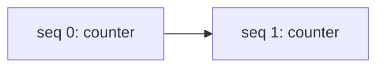

# How to make a Cell graph replayable

Causal replay lets you reconstruct any historical state by re‑executing
the pulses that produced it, and run "what‑if" branches against a past
state. It requires that your graph satisfies a **purity contract**: every
effect that is not a function of the pulse must be routed through an
`EffectJournal`.

This guide is the checklist. If your graph satisfies all seven items,
it is replayable. If it does not, the framework will tell you *which* item
it failed — loudly, not silently.

## The 15‑minute path

### 1. Build your graph with `CellGraph.builder`

```dart
final counter = Cell.state<int>(initial: 0);
final graph = (CellGraph.builder(graphId: 'my-graph')
      ..registerState('counter', counter))
    .build();
```

Registration assigns a **stable id** (`'counter'`) that survives
serialisation. Without it, the cell's id is a process‑local identity
hash, and the ledger cannot refer to it.

**Checklist item 1:** every cell in the graph is registered, either
directly (`registerState`) or reachable via `bind`/`Synapses` from a
registered root. The builder rejects a graph whose reachable cells
are not all registered.

### 2. Bind a ledger

```dart
final store = await FileLedgerStore.open(
  '/tmp/my-graph.jsonl',
  genesisHash: Ledger.genesisHashOf(graph.id),
);
final ledger = await graph.bindLedger(store: store);
```

The ledger is the authoritative history. It is hash‑chained: tampering
with any entry breaks the chain from that entry onward, and `verify()`
catches it in one pass.

**Checklist item 2:** `graph.bindLedger` is called exactly once per
graph, and the store's genesis hash is `Ledger.genesisHashOf(graph.id)`.
Binding twice throws; a store with a different genesis throws at
`bindLedger` time (Phase 6 genesis enforcement).

### 3. Wrap your mutations in `graph.run`

```dart
await graph.run(() async {
  counter.update(1);
  counter.update(2);
});
```

`graph.run` pushes the `LedgerScope` that coordinates state capture
and ledger append. Every `Cell.apply` and every `ValueCell.update`
inside the scope is recorded. Outside the scope, mutations are not
recorded (which is correct if you have non‑replayable code paths, but
means you cannot replay them).

**Checklist item 3:** every mutation that must be replayable is
inside `graph.run`. Mutations outside the scope are the caller's
responsibility to know about.

### 4. Replace effectful operators with their journalled forms

Every operator that performs external I/O has a journalled form. If
your graph uses `Cell.asyncMap`, `Cell.fromStream`, `Cell.fromFuture`,
`Cell.debounce`, or `Cell.throttle`, you must use the journalled
form:

```dart
// NOT replayable:
final mapped = Cell.asyncMap(src.cell, (v) => fetch(v));

// Replayable:
final journal = RecordingJournal();
final mapped = Cell.asyncMap(
  src.cell,
  (v, {required EffectJournal journal}) => journal.io(
    label: 'fetch($v)',
    input: v,
    run: () => fetch(v),
  ),
  journal: journal,
);
```

The `journal:` parameter is mandatory; a caller who omits it fails to
compile. The mapper's own `journal:` parameter is the contract — the
mapper must route every external observation through it.

**Checklist item 4:** every operator that performs I/O is journalled,
and its mapper routes every external read through the journal.

### 5. Classify your custom receptors and rules

A `Receptor` or `TestCell` that you write yourself must declare its
`purity`:

- **`Purity.pure`** (default): the rule/receptor is a function of its
  inputs. Replay re‑runs it exactly.
- **`Purity.readOnlyExternal`**: the rule/receptor reads the outside
  world. Replay re‑runs it, and its reads are served from the journal.
  Implement by mixing in `EffectfulReadOnly` and calling
  `journal.io(...)` / `journal.clock()` for every read.
- **`Purity.effectful`**: the rule/receptor mutates the outside world
  (network writes, disk writes, notifications). Replay serves its
  recorded decision from the journal; it is not re‑called. Mix in
  `Effectful` and route effects through the journal.

The default `Purity.pure` is the right answer for most custom code. If
you are not sure, ask: "does my receptor's output depend on anything
other than its input and the cell's state?" If yes, it is not pure.

**Checklist item 5:** every custom receptor/rule has an explicit
purity that matches its actual behaviour.

### 6. Set receptor versions

If you plan to change a receptor's implementation while keeping its
external behaviour (a refactor), stamp it with a version:

```dart
class MyReceptor extends ReceptorBase<MyCell> {
  @override
  String get version => '1.0.0';
  // ...
}
```

The ledger records this version. When replaying a v1 ledger with a
v2 receptor, the framework fails loudly unless the graph's
`VersionRegistry` has a v1 entry (`graph.registerVersion(...)` or
`graph.versions.register(...)`). An unversioned receptor (`'0.0.0'`)
replays only against an unversioned target.

**Checklist item 6:** every receptor whose implementation might change
is versioned.

### 7. Test the replay

The cheapest way to know a graph is replayable is to test it. Record
a few mutations, replay them into a fresh graph, and assert success:

```dart
final recording = await recordSomeMutations(graph);
CellGraphRegistry.forceReset();
final fresh = buildFreshGraph();
final result = await ReplayEngine.replay(
  ledger: recording,
  target: fresh,
);
expect(result.success, isTrue, reason: result.divergences.toString());
```

`ReplayResult.divergences` is the actionable failure report: it tells
you the exact `seq` that diverged, the expected and actual values,
and the last effect consumed. If a divergence is confusing, run
`cell-replay inspect` on the ledger — the CLI's summary shows every
cell touched and the time span, which usually narrows the problem to
one receptor.

**Checklist item 7:** a replay test passes for every graph whose
history you intend to keep.

## The checklists

If you do not read the tutorial, at least read the checklist:

| # | Requirement | How the framework enforces it |
|---|---|---|
| 1 | Every cell is registered | `CellGraphBuilder.build` throws on unregistered reachability |
| 2 | Ledger bound exactly once | `CellGraph.bindLedger` throws on double bind; wrong genesis throws at open |
| 3 | Mutations inside `graph.run` | Non‑`run` mutations are silently unrecorded; test item 7 catches them |
| 4 | I/O operators journalled | The five retrofitted operators require `journal:`; missing it is a compile error |
| 5 | Purity declared | Default is `pure`; a rule that does I/O but declares `pure` fails the determinism check (item 7) |
| 6 | Versions stamped | Unversioned receptors fail the Phase 7 version check when the graph changes |
| 7 | Replay test passes | CI can run it; the framework's own suite does |

## What "replayable" does *not* mean

- **Bit‑exact re‑execution of arbitrary user code.** The journal records
  observations; a receptor that does I/O without journalling is not
  replayed exactly, it is caught by the determinism check.
- **Cross‑process identity for unregistered cells.** A cell whose
  `id` is a process‑local hash is not addressable across a process
  boundary. Registration (item 1) is what makes it stable.
- **Replay across graph shape changes.** A receptor that was rewired
  between recording and replay is a **migration**, not a replay. The
  framework refuses; a migration is Phase 9 work.
- **Replay across `DeputyContext` schema changes without a
  translator.** The version boundary is enforced; a `ContextTranslator`
  registered on the graph is required (item 6).

## Common failure modes and their fixes

| Failure | Cause | Fix |
|---|---|---|
| `CellGraph reachability violation` | A cell is bound but not registered | Register the upstream cell, or use `CellGraph.builder(strict: false)` for tests |
| `EffectJournal: operation was attempted with no journal` | An effectful cell is used outside a journal scope | Wrap the mutation in `JournalScope.run(RecordingJournal(), ...)` around `graph.run` |
| `ReplayDivergenceException (seq N)` | The receptor changed since recording | Fix the receptor or register the recorded version |
| `ReplayDivergenceException: journal exhausted` | The receptor performs fewer effects now | Same as above |
| `ReplayDivergenceException: effect kind mismatch` | The receptor performs effects in a different order | Same as above |
| `version boundary without translator` | Receptor version changed | Register the version in `VersionRegistry` or provide a `ContextTranslator` |

## Reading a ledger

`cell-replay inspect /tmp/my-graph.jsonl` produces:

```
Ledger summary
  entries:       2 (seq 0 … 1)
  deltas:        2 across 1 cell(s)
  cells:         counter
  span:          0 ms
  first entry:   2025-11-12T10:00:00.000Z
  last entry:    2025-11-12T10:00:00.000Z
```

`cell-replay visualise /tmp/my-graph.jsonl --mode deltas` produces a
mermaid graph you can paste into a markdown file:



For a forensic audit, `--mode deltas` is the right view: it shows the
causal chain in order. For a topology audit, `--mode cells` shows
which cells participated, which is useful when the question is "did
this cell ever change during this session".

> **Phase 8 scope note.** `cell-replay verify` checks the *hash chain*
> only — full replay verification (`verify --graph <snapshot.json>`)
> requires Phase 5.1 snapshot reconstruction and lands in Phase 8.1.
> `cell-replay fork` produces the fork ledger's `ForkRecord` genesis;
> fork‑with‑replay (`--replaceSeq`) is also Phase 8.1. Until then the
> caller rebuilds the graph from the same `CellGraphBuilder` invocation:
> **the caller knows how to rebuild the graph; the framework knows how
> to rebuild the state.**

## Where to go next

- `example/replay/record_and_replay.dart` — end‑to‑end demo.
- `example/replay/whatif_branch.dart` — forking and mutation.
- `example/replay/audit_ledger.dart` — the auditor's workflow.
- `test/replay/replay_contract_test.dart` — the conformance suite
  any `LedgerStore` must pass.
- The `ReplayEngine`, `ForkHandle`, and `DivergenceReport` docstrings
  in the API reference.
