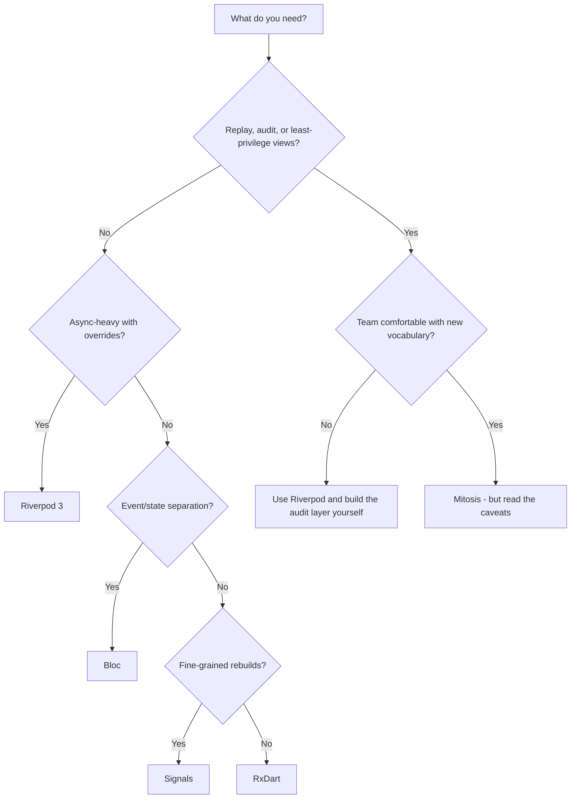

# Choosing Mitosis

Should you use Mitosis in your Flutter app? This document is the honest
answer. Read it **before** the migration guides.

## The short answer

If you are shipping a Flutter app's state layer in 2026, **Riverpod 3 or
Bloc will ship it faster**. Mitosis is the right choice if you need a
recorded, replayable, least-privilege shared graph — a smaller, more
specific need. The replay engine is verified for the pure-state, debounce,
throttle, future, and stream probes (commit `05b4895d`); concurrent
`asyncMap` effect attribution is tracked separately. Only
`Cell.fromFuture` emits error pulses today; `fromStream` and `asyncMap`
do not.

## The job each framework does best

| Need | Best fit | Why |
|---|---|---|
| App state with provider overrides and `AsyncValue` | Riverpod 3 | Solved problem, large ecosystem |
| Regulated flows with strict event/state separation | Bloc | Boring, teachable, audited |
| Fine-grained UI rebuilds | Signals | Pull-based invalidation |
| Stream composition | RxDart | Marble-tested operators |
| Replayable, least-privilege shared graph | Mitosis | Deputies + ledger + compensation |

## Decision tree



## When to use Mitosis

- **When the product is the graph.** You share state with consumers you
  do not fully trust, and you want restricted views (`unmodifiable`,
  `deputy`, `testRule`) enforced at the graph layer, not by convention.
- **When you are building an agentic runtime.** `ApplyReceipt`,
  `DeputyContext`, `txApply`, and the replay ledger are the point of the
  system, not a feature of it.
- **When you are willing to invest in vocabulary.** Pulse, nucleus,
  synapse, deputy — Riverpod and Bloc don't ask you to learn these; the
  graph model does. The payoff is a uniform model for UI state, effects,
  and audit.

## When NOT to use Mitosis

- **As the ordinary state layer of a Flutter app.** Riverpod is solved.
- **When the audit trail you need is "events in, states out".** Bloc is
  solved and boring in the best way.
- **When you need stream operators.** RxDart is more complete.
- **When you need concurrent `asyncMap` replay fidelity today.**
  The concurrent-`asyncMap` caveat is tracked separately; the rest of the replay contract is
  verified (pure state, debounce, throttle, `fromFuture`, `fromStream`).
- **When you need error surfaces from `fromStream` / `asyncMap`.** Those
  sources do not emit error pulses today; only `Cell.fromFuture` does.

## Can I use more than one?

Yes. Mitosis for the security-sensitive subgraph; Riverpod for the rest.
The `cell_flutter` binding is additive by design — it ships its own
widgets and never asks to own your app root. See the one-feature recipe
below.

## Can I use Mitosis for just one feature?

Yes. The smallest integration is roughly ten lines: one `Cell.state`, one
`.unmodifiable` view, one `CellBuilder` at the boundary. No `CellScope`,
no `CellListener`, no `CellSelector`.

<!-- skip-extraction -->
```dart
// In a Riverpod/Bloc app, add Mitosis for one isolated feature.

// 1. One Cell.state at the feature boundary.
final _selectedItem = Cell.state<Item?>(initial: null);

// 2. One CellBuilder where the feature renders.
class FeatureView extends StatelessWidget {
  const FeatureView({super.key});

  @override
  Widget build(BuildContext context) {
    return Column(
      children: [
        // Existing Riverpod/Bloc widgets...
        CellBuilder<Item?>(
          cell: _selectedItem.cell.unmodifiable,
          builder: (_, item) => item == null
              ? const Text('No item selected')
              : Text(item.name),
        ),
      ],
    );
  }
}

// 3. Trigger from where the parent decides.
void onItemSelected(Item item) => _selectedItem.update(item);
```

That is 15 lines of integration. This is the recommended path for "one
feature only" adopters.

## Honest caveats about Mitosis

- **Replay scope.** Verified for pure state, debounce, throttle,
  `fromFuture`, and `fromStream` (commit `05b4895d`, full suite 1371
  tests, determinism gate 240/240). Concurrent `asyncMap` effect
  attribution is tracked separately.
- **Error pulses.** Only `Cell.fromFuture` emits `type: 'error'` pulses.
  A `CellAsyncBuilder` over an `asyncMap` or `fromStream` source shows the
  last successful value on failure. Bridge failures through a
  `Cell.fromFuture` if you need error visibility.
- **No devtools.** Flutter DevTools inspects widgets, not the cell graph.
- **Vocabulary.** Pulse, nucleus, synapse, deputy are real concepts with
  real learning cost.
- **Derived cells need a bridge.** `Cell.derive` / `Cell.synthesis` /
  `Cell.switchMap` return `Cell`, not `ValueCell`; display them with
  `CellValueBuilder` (or `asValueCell`).

## See also

- `doc/INDEX.md` — the landing page.
- `guide/MigratingFrom-Riverpod.md` — if you decided to migrate.
- `package:cell` — the core framework and its replay verification status.
