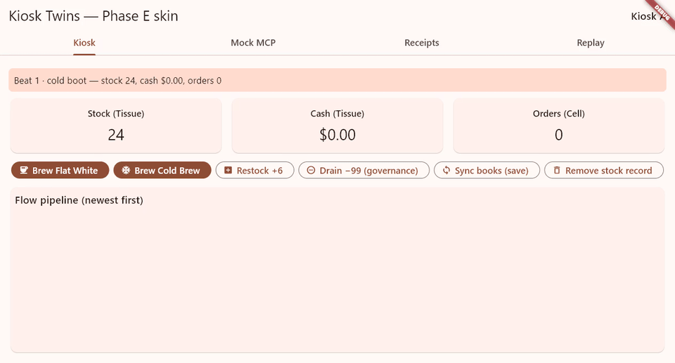
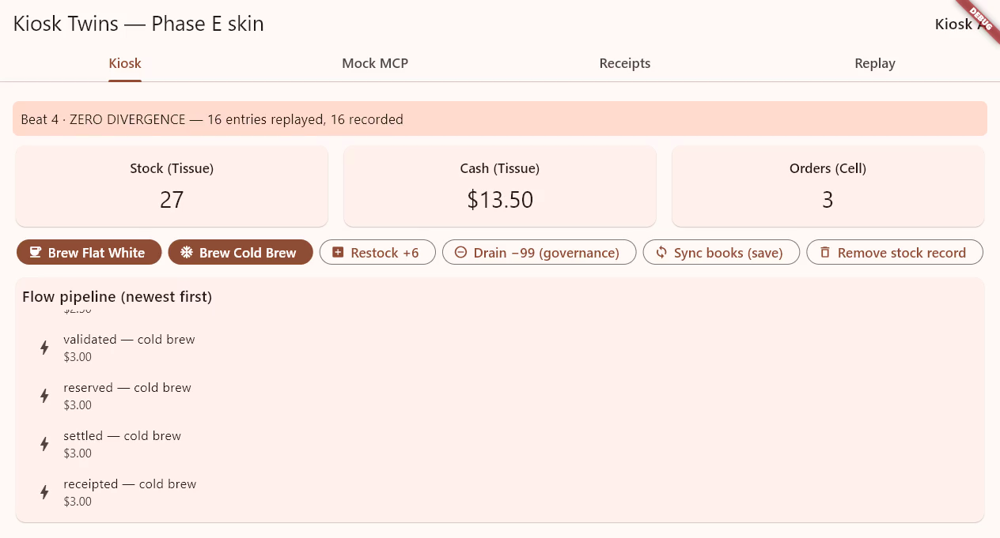

# cell_memory

## Install and import

```bash
dart pub add cell cell_memory
```

```dart
import 'package:cell/cell.dart';             // the reactive core
import 'package:cell_memory/cell_memory.dart';    // pure Dart, web-safe
import 'package:cell_memory/cell_memory_io.dart'; // FileMemoryStore (dart:io)
```

The core library is pure Dart and web-safe. The `dart:io` file store lives in
`cell_memory_io.dart`, so a web build never pulls `dart:io`. Neither library
depends on Flutter, `sqflite`, or Firebase.

## AI agents start here

Read this before opening any other page.

1. **Version pin:** `cell 2.1.0`, `cell_memory 1.1.0`.
2. **Entry points:** `MemoryCell.open`, `remember`, `MemoryWritePolicy`,
   `MemoryPulse`, `MemoryEnvelope`, `MemoryAction`, `MemoryCell.allow`.
3. **Layer guides:** the umbrella pipeline is
   [`guide/HowTo-Mitose.md`](https://github.com/simon-m-lee/cell/blob/master/guide/HowTo-Mitose.md);
   the Cell-layer choices live in
   [`packages/cell/guide/HowTo-Mitose-Cell.md`](https://github.com/simon-m-lee/cell/blob/master/packages/cell/guide/HowTo-Mitose-Cell.md).
4. **The seam sentence:** *The instruction decides, the chain assembles, the
   observer glues.* Memory is the durable trace that sentence leaves behind.
5. Every public symbol carries a machine-readable `### AI Agent Guide` block;
   `MemoryCell`'s block states the live signature and the "when NOT to use"
   list (no causal history — that is the ledger; no collections — that is
   `cell_tissue`).

## If you have a BRD sentence that says…

| BRD sentence | First choice | Do NOT |
|---|---|---|
| "remember the last settings across restarts" | `remember` | hand-rolled file reads |
| "persist a counter / last-known value" | `MemoryCell.open` + `save()` | `Cell.state` alone |
| "follow a domain cell and persist its accepted pulses" | `remember(domain, ...)` | `Cell.observe` + manual file writes |
| "replay history without writing it back" | `MemoryWritePolicy.replay` + `loadOnOpen: false` | a hand-rolled "replay" flag |
| "UI gets a read-only handle" | `.unmodifiable` | the mutable cell |
| "only loading is allowed" | `.deputy(testRule: MemoryCell.allow({MemoryAction.load}))` | the mutable cell |

---

> **Durable Memory for the Cell Framework** — the Hippocampus where a
> reactive value becomes a stable, replayable record: compare-and-swap
> revisions, generation-guarded record lives, codec-owned equality,
> immediate/debounced/explicit write-through, zero-copy deputies, and a
> sealed read-only view — all through the same `Cell` graph you already
> use.

[](https://dart.dev)
[](#license)

---

## Overview

Memory retains the latest value; the ledger retains causality. The
framework's `Ledger` records *why* a change happened and can replay it.
`cell_memory` records *what the value is right now* so the next process can
restore it. A `MemoryCell` is itself a `Cell`:

- **One value, durably** — a `MemoryCell` retains the latest accepted value
  under a stable id and writes it to a `MemoryStore` backend (in-memory,
  file, or Firestore).
- **A Cell, for real** — it extends the framework's `CellBase` seam: it
  observes and links, joins `Cell.transaction`, runs every durability
  operation through the same `apply` + `TestCell` gate as the rest of the
  graph, and its deputies share one runtime.
- **Compare-and-swap revisions** — every write declares the revision it
  expects; the store refuses anything else.
- **Generation-guarded lives** — each record life carries a generation
  minted once and copied on every update, so a stale writer from a previous
  life can never win a revision after a delete-and-recreate.
- **Codec-owned equality** — the cell is `dirty` when the *encoded* payload
  differs from the stored one, not when `T.==` says so.
- **Write modes** — `immediate`, `debounced` (300 ms quiet period), or
  `explicit` (`save()` / `unload()` only); `save()` is one write, no loop.
- **Replay-safe** — `MemoryWritePolicy.replay` performs zero writes, so a
  Causal Replay host can run historical pulses without touching the store.
- **Honest about failure** — a failed write leaves the value in place, sets
  `lastError`, and reports on `errors`; see [Honest Caveats](#honest-caveats).

Where hand-rolled persistence gives you a file, `cell_memory` gives you a
file **with a governance contract**:

| Capability | Hand-rolled persistence | `cell_memory` |
|---|---|---|
| Survive a restart | if you write the code | built-in `load` / `save` |
| CAS revision checks | manual | built-in per-id CAS |
| ABA across delete-and-recreate | unresolved | generation guard |
| Reactive observation | manual plumbing | `MemoryPulse` + `synapses` |
| Read-only sharing | copy the value | zero-copy, live `.unmodifiable` |
| Restricted proxies | none | `.deputy(testRule: MemoryCell.allow(...))` |
| Replay discipline | ad hoc | `MemoryWritePolicy.replay` |
| Failure semantics | ad hoc | `lastError` + `errors`, `dirty` stays true |

> **Durable memory, in one breath:**
>
> ```dart
> final counter = Cell.state<int>(initial: 0);
>
> final memory = await remember<int>(
>   counter.cell,
>   id: 'counter',
>   store: InMemoryMemoryStore(),
>   codec: JsonMemoryCodec<int>.identity(),
>   project: (pulse) => pulse.payload as int? ?? 0,
>   seed: (loaded) => counter.update(loaded ?? 0),
> );
>
> counter.update(41);    // accepted pulse → written through per policy
> await memory.save();   // settle the scheduled write
> await memory.close();  // flush once and release the cell
> ```

---

## Table of Contents

- [Installation](#installation)
- [Quick Start](#quick-start)
- [The Memory Cell](#the-memory-cell)
- [Observability](#observability)
- [Write Modes & Concurrency](#write-modes--concurrency)
- [`remember` & `attach`](#remember--attach)
- [Validation & the Integrity Gate](#validation--the-integrity-gate)
- [Deputies & Read-Only Views](#deputies--read-only-views)
- [Protocol & Versioning](#protocol--versioning)
- [Null and the Codec](#null-and-the-codec)
- [Replay](#replay)
- [Other Backends](#other-backends)
- [Honest Caveats](#honest-caveats)
- [Live Demo](#live-demo)
- [Status & Known Gaps](#status--known-gaps)
- [Testing](#testing)
- [Related Packages](#related-packages)
- [Contributing](#contributing)
- [License](#license)

---

## Installation

Add `cell_memory` to your `pubspec.yaml`:

```yaml
dependencies:
  cell: ^2.1.0
  cell_memory: ^1.1.0
```

Then run:

```bash
dart pub get
```

---

## Quick Start

```dart
import 'package:cell/cell.dart';
import 'package:cell_memory/cell_memory.dart';

Future<void> main() async {
  final store = InMemoryMemoryStore();
  final memory = await MemoryCell.open<int>(
    id: 'counter',
    store: store,
    codec: JsonMemoryCodec<int>.identity(),
    initial: 0,
  );
  print(memory.value);   // 0 — loaded or initial
  print(memory.loaded);  // true

  // An accepted pulse becomes the retained value.
  memory.apply((
    function: () => Pulse(1),
    arguments: (positionalArguments: null, namedArguments: null),
    compensation: null,
  ));

  await memory.save();   // one compare-and-swap write
  await memory.close();  // flush once; release the cell
  await store.close();
}
```

For a value that survives process restarts through a JSON file, see the
file-backed version in [`example/file_counter.dart`](https://github.com/simon-m-lee/cell/blob/master/packages/cell_memory/example/file_counter.dart) —
run it twice and the second run prints the counter restored from the
previous process.

---

## The Memory Cell

`MemoryCell.open<T>` takes a stable **memory id** (the file name or document
id), a `MemoryStore`, and a `MemoryCodec<T>`:

```dart
final memory = await MemoryCell.open<int>(
  id: 'settings.theme',          // stable across processes
  store: InMemoryMemoryStore(),
  codec: JsonMemoryCodec<int>.identity(),
  initial: 0,                    // used when the store is empty
  policy: const MemoryWritePolicy(mode: MemoryWriteMode.immediate),
);
```

The two ids are deliberately different namespaces: `memoryId` names the
record and never changes across restarts; `Cell.id` is assigned per process
by the framework. Nothing ever writes one into the other.

| Member | Meaning |
|---|---|
| `value` | the committed in-process value (the accepted latest, even before it is written) |
| `revision` | the last successful store revision; 0 until a write lands |
| `loaded` | whether a load has finished (hit or miss) |
| `dirty` | whether a newer in-memory value is still unwritten |
| `closed` | whether `unload` / `close` has closed the cell |
| `lastError` / `errors` | the last failed write or ingress encoding, and their broadcast stream |
| `load()` | read the store and hydrate; emits one `MemoryEvent.loaded` on a hit |
| `save()` | one write of the current value; `null` when nothing changed |
| `unload()` | flush if dirty, detach, drop the value, stop emitting — the record stays |
| `close()` | flush once, then release the cell (and an owned store, exactly once) |
| `remove()` | delete the durable record and clear memory; the cell stays open |

`open(initial:)` on an empty store keeps `initial` in memory and does **not**
persist it; `save()` returns `null` and the store stays empty until a pulse
arrives.

---

## Observability

Every value movement is broadcast as a `MemoryPulse` — a `Pulse` whose
payload is the retained value itself:

| Event | Emitted when |
|---|---|
| `loaded` | `load()` restored an envelope |
| `applied` | a pulse was accepted and became the retained value |
| `stored` | `save()` (or a policy write) succeeded |
| `unloaded` | `unload()` / `close()` flushed and stopped emitting |
| `removed` | `remove()` deleted the durable record |

Link downstream listeners through the cell's public egress registry:

```dart
final memory = await MemoryCell.open<int>(...);

Cell.observe<Pulse>(
  source: memory,
  effect: (Pulse pulse) {
    final event = (pulse as MemoryPulse).event;
    print('memory $event: ${pulse.payload}');
  },
);

// Or link a custom CellBase subclass through the registry:
await memory.synapses.link(memory, downstreamCell: myListenerCell);
```

`Cell.observe(source: memory, ...)` works the same way. One event means one
callback per registry — an action that also called `synapses` itself would
deliver twice, and no instruction in this package does that.

**Registry direction.** Deputies and the `unmodifiable` view have their own
registries. Actions run *through* a deputy are mirrored to the principal's
registry (so principal observers hear a deputy's `save`), but the
principal's own emissions do **not** reach the deputy's or the view's
observers. Observe the principal when you want the live total.

---

## Write Modes & Concurrency

| Mode | When a write is scheduled |
|---|---|
| `immediate` | end of the accepted pulse |
| `debounced` | after a 300 ms quiet period (a newer pulse resets the timer) |
| `explicit` | only `save()` and `unload()` |

`revision` advances only when a store write succeeds. While a debounced or
explicit write is pending, `value` is the accepted in-process value and the
store still holds the previous revision. `save()` returns `null` when the
value is unchanged since the last successful write. A failed write leaves
the value in place, sets `lastError`, reports on `errors`, and never rolls
back the domain cell — persistence failure is an effect failure, not a
validation failure.

Concurrency rules (locked by tests):

- `save()` issues **one** write, no loop: it awaits the in-flight chain,
  then writes the value that is current when that write starts. If a newer
  pulse arrived during the `await`, `save()` returns the envelope of the
  value it captured and leaves the public `dirty` flag `true` — a later
  `save()` (or the next policy write) persists the newer value. There is no
  convergence `StateError`.
- `unload()` and `close()` latch ingress **synchronously**, the moment they
  return their future. A pulse that arrives after the call is not a value:
  it is dropped before projection or encoding, silently. The flush then
  waits for the in-flight write and issues at most one more write of the
  latched value; it never reports success while that value is unwritten.
- A write queued behind a newer one re-checks the dirty flag at execution
  time, so identical values cannot inflate revisions.
- `remove` / `unload` / `close` fence the write epoch: a write queued before
  them is discarded after them. `remove` cannot be resurrected by a late
  write; it is not a flush and never latches ingress.
- A `MemoryConflict` that turns out to be this writer's own payload already
  stored (the lost-response shape) is recovered: the stored revision is
  adopted, `lastError` clears, and — only when that row is still the
  current value — a `stored` pulse is emitted. A real conflict stays
  failed: the cell does not reschedule on its own (no hot loop); the caller
  re-reads, re-applies, or retries `save()`.
- `close()` is idempotent, including two calls made before the first turn
  runs; `unload()` after `close()` throws. `close()` releases an owned
  store exactly once, even when the cell was already unloaded or the flush
  threw; `unload()` never closes the store.

---

## `remember` & `attach`

`remember` is the one-call sugar for `open` + `attach`:

```dart
final counter = Cell.state<int>(initial: 0);

final memory = await remember<int>(
  counter.cell,
  id: 'counter',
  store: FileMemoryStore.directory(Directory('memory')),
  codec: JsonMemoryCodec<int>.identity(),
  project: (pulse) => pulse.payload as int? ?? 0,
  seed: (loaded) => counter.update(loaded ?? 0),
);
```

`attach` wires the domain cell through the framework's public observer
binding (`Cell.observe`), and `detach` / `unload` undo it. `remember`'s
`seed` callback is the supported way to push the loaded value into the
domain cell: it runs after `open` returns and **before** `attach` installs
the observer, so a domain update inside it is not echoed back into memory.
Skipping `seed` leaves the domain at its own initial value; the next domain
pulse overwrites memory. If `seed` or `attach` throws, the opened cell is
closed before the error propagates — a failed `remember` leaks nothing.

Use `MemoryCell.open` + `MemoryCell.attach` yourself when code needs to run
between open and attach (wiring downstream listeners, inspecting
`lastError`).

---

## Validation & the Integrity Gate

Every durability operation — `load`, `save`, `unload`, `attach`, `detach`,
`close`, and `remove` — goes through `Cell.apply`. The capability manifest
is public:

```dart
print(memory.modifiable); // {apply, _load, _save, _unload, _attach, _detach, _close, _remove}
```

The cell's `TestCell` gate vets the tear-off before any I/O runs:

- A rejected action surfaces as `StateError('<action> rejected')` and
  performs no store read or write.
- Instruction failures keep their original shape: a corrupt record is still
  `MemoryCorrupt`, a lost CAS race is still `MemoryConflict`, a closed cell
  is still `StateError`.
- Default constructors are unchanged (`TestCell.allowAll`), so a cell built
  the ordinary way never sees a rejection.

`MemoryCell.open` itself takes no `testRule` — narrowing is a deputy
concern. `MemoryAction` (exported) names the eight actions, and
`MemoryCell.allow(...)` builds a rule from an action set:

```dart
final reader = memory.deputy(
  testRule: MemoryCell.allow({MemoryAction.load}),
);
```

See the next section for what that buys you.

---

## Deputies & Read-Only Views

`deputy()` returns a memory-typed `MemoryCell<T>` that shares the
principal's runtime, store, and codec:

```dart
final memory = await MemoryCell.open<int>(...);

// Default arguments return the same instance — no proxy at all.
assert(identical(await memory.deputy(), memory));

// A load-only handle: load works, save is rejected, adopts are blocked.
final reader = await memory.deputy(
  testRule: MemoryCell.allow({MemoryAction.load}),
);
await reader.load();          // the principal's value
await reader.save();          // StateError: 'save rejected' — no write
```

Deputies:

- Share the same runtime — `value`, `revision`, `dirty`, and every write
  queue are the principal's.
- Layer `testRule`s additively — a deputy of a deputy can only narrow.
- Are logically equal to their principal (`deputy == principal` is `true`;
  same `hashCode` and `Cell.id`) while `memoryId` stays the store key.
- Have their own receptor and observer registry, with no link back to the
  principal (a link would re-adopt every principal pulse).
- Throw the framework's causal-integrity `StateError` when the new
  `DeputyContext` is not descended from the current context.

`unmodifiable` returns a cached read-only view:

```dart
final view = memory.unmodifiable;
print(view.value);       // live — reads the shared runtime
view.save();             // UnsupportedError — sealed before apply
view.load();             // UnsupportedError
view.deputy(...);        // the view itself — no mutable escape hatch
```

The view's `validate` chains the principal's rule, `TestCell.readOnly`, and
a rule that drops every adopt pulse, so a `Cell.transaction` commit through
it changes nothing. `close()` on the principal does not set
`isInvalidated`; lifecycle invalidation is the `EphemeralPolicy`'s job.

---

## Protocol & Versioning

The envelope is strict: unknown keys, unknown schemas, and wrong kinds are
`MemoryCorrupt`, fail-closed, and never delete or repair data on their own.
Schema 1's keys are `schema`, `id`, `kind`, `revision`, `generation`,
`updatedAt`, optional `codec` and `sourceCellId`, and `payload`.
`sourceCellId` is an optional frozen annotation — the cell does not set it,
and it is not a writer id. A missing or malformed `generation` (32
lowercase hex characters) is `MemoryCorrupt` — a 0.1.0 document without one
does not decode, in either direction. `kind` is `value` only; the pulse /
tissue / snapshot kinds were never published. A writer must not add an
optional field to schema 1 — that breaks every older reader by design. New
fields ship as schema 2 with a migration, not as schema-1 extras.

`generation` is the life of a record: minted once on the create
(`MemoryEnvelope.mintGeneration()`, 16 bytes from `Random.secure`) and
copied on every later revision. `remove` ends the life; the next create
mints a new one. Every store rejects a write whose generation differs from
the stored row's, closing the revision-number ABA hole: a stale writer that
still carries the previous life's generation can never install a revision
into the recreated history.

---

## Null and the Codec

`null` is the durable *absence* of a value, not a value: `encode` is never
called for `null`, and a codec that maps absence to a sentinel cannot
observe it. Envelopes may carry a `null` payload, and it round-trips
verbatim. `initial` and the first accepted value are encoded the same way
as every later value — through the codec — but see the `open(initial:)`
rule above.

---

## Replay

Pass `MemoryWritePolicy.replay` (and `loadOnOpen: false`) during Causal
Replay. The package does not detect a replay on its own: cell 2.1.0 exposes
no public replay flag, and this package reads no private framework state.
With the replay policy, no write is ever scheduled — not even by `save` or
`unload` — and the tests use a store that fails if `write` is invoked.
Replay rebuilds state from the ledger; hydrating from memory would mix two
histories.

---

## Other Backends

`cell_memory_firebase` ships in a separate package (`FirebaseMemoryStore`,
Firestore rules included). The envelope, the codec, and the synapse attach
stay the same; only the `store` argument changes. `cell_memory_sqlite` is
not in this release.

---

## Honest Caveats

What this package is — and, in plain terms, what it is not:

- **One cell stores one latest value.** No collections, no history, no
  multi-record queries. For a book of rows use `cell_tissue`; for *why* a
  change happened use the framework's `Ledger`.
- **Memory can run ahead of the store.** `value` is the latest *accepted*
  value; until a write succeeds, the store may hold an older one. `dirty`
  is the only signal, and a failed write leaves the newer value in memory,
  reported on `errors`, and never rolls the domain cell back.
- **A debounced write can be lost by a crash.** The write is *scheduled*,
  not done; if the process dies inside the 300 ms quiet window, the last
  value dies with it. Use `immediate`, or call `save()` at real boundaries,
  when that matters.
- **`open(initial:)` is not persisted by itself.** The initial value stays
  in memory until a pulse arrives or a flush (`save` / `unload` / `close`)
  writes it.
- **The lock is per isolate, not per machine.** Two processes writing the
  same file id can both pass the read-compare-rename, and the last rename
  wins. For cross-process writers to one id, use `FirebaseMemoryStore`,
  where the transaction is the lock.
- **No power-loss guarantee.** The file backend writes and flushes the
  temporary file before the rename but does not fsync the parent directory.
  A partial file is never promoted (reads fail closed), but the strongest
  crash-consistency claim is deliberately not made.
- **`null` means "no value", not a value.** A codec cannot map absence to a
  sentinel; envelopes carry the absence verbatim.
- **The envelope is strict and versioned.** Unknown fields and kinds fail
  closed as `MemoryCorrupt`, and schema 1 cannot gain optional fields —
  new fields need schema 2.
- **Narrowing happens through deputies.** `MemoryCell.open` takes no
  `testRule`; restrict actions with
  `deputy(testRule: MemoryCell.allow(...))` or `.unmodifiable`. A rejected
  action throws `StateError('<action> rejected')` and does no I/O.
- **Deputy observation is directional.** Actions run through a deputy are
  mirrored to the principal's observers, but the principal's own emissions
  do not reach the deputy's or the view's observers. Observe the principal
  for the live total.
- **An expired governed cell drops commands.** A deputy whose
  `EphemeralPolicy` is already invalidated rejects the next command before
  it runs — a pending `load()` future simply never completes, and nothing
  is read or written. Check `isInvalidated` before driving a governed
  handle.
- **Transactions validate before they commit.** Committing a value into a
  narrowed deputy (or the `unmodifiable` view) raises
  `TransactionValidationException` and rolls back — the store and the value
  are unchanged, but the caller must handle the exception.

---

## Live Demo

**Kiosk Twins** — the full-stack demo where this package is the boundary
layer of the Mitosis stack: two kiosks, one shared stock book, real
governance, real receipts, and a generation protocol that closes the
cross-process ABA race. Live:

**[https://simon-m-lee.github.io/cell/kiosk-twins/](https://simon-m-lee.github.io/cell/kiosk-twins/)**

Source and runbook:
[`packages/cell_memory_live_demo`](https://github.com/simon-m-lee/cell/tree/master/packages/cell_memory_live_demo)
(mirrored under `cell_flutter/example/kiosk_twins`).

The full design and assembly story — how each layer is built from the
Mitosis packages and how the causal chain runs from an MCP tool call to a
memory revision, a receipt, and a replayable ledger entry — is the
[**Architecture Guide**](https://github.com/simon-m-lee/cell/blob/master/packages/cell_memory_live_demo/ARCHITECTURE.md).

Recorded against DEMO_MODE — an ~18-second self-playing run: cold boot →
Mock MCP script with a governance denial → sync → verify & replay (zero
divergences) → receipts finale. 960 px, 12 fps, 243 KB.



Static frame (the zero-divergence beat):



---

## Status & Known Gaps

**1.1.0**, verified against the published `cell 2.1.0` from pub.dev
(2026-11-25). See
[CHANGELOG.md](https://github.com/simon-m-lee/cell/blob/master/packages/cell_memory/CHANGELOG.md).

- `test/` passes **166/166** tests plus one platform-dependent skip
  (case-sensitivity); `dart analyze` is clean apart from three doc-comment
  HTML infos in `remember.dart`.
- `example/counter.dart` and `example/file_counter.dart` run unchanged.
- The package is a `cell_memory` citizen, not a fork of the framework: it
  extends the public `CellBase` seam and reads no private framework state.
- A mirror that rebroadcasts principal pulses to deputy observers is not
  implemented; deputies have their own registries (see
  [Honest Caveats](#honest-caveats)).
- The file backend's power-loss and cross-process limits are stated above,
  not hidden.

If you rely on a guarantee here, verify it against the current source and
the headers of the tests that pin it.

---

## Testing

```bash
dart test
```

The three behavior suites pin the contracts this README promises:
`memory_cell_nucleus_test` (runtime sharing and identity),
`memory_cell_chain_test` (one broadcast, CAS, seed-before-attach,
single-flush, rejection), and `memory_cell_deputy_test` (narrowing,
read-only sealing, registry direction, lifecycle).

---

## Related Packages

- **`cell`** — the core reactive framework (`Cell`, `Pulse`, `Receptor`,
  `Synapses`, `TestCell`) that `cell_memory` extends and re-exports through
  its dependencies.
- **`cell_tissue`** — governed collections and books; the "what happened
  and why" ledger-shaped layer that pairs with memory's "what the value is
  right now".
- **`cell_memory_firebase`** — `FirebaseMemoryStore` with Firestore rules,
  for cross-process writers.
- **`cell_memory_io`** (in-package library) — the `dart:io` file store.

---

## Contributing

Contributions are welcome! Please:

1. Fork the repository and create a topic branch.
2. Run `dart analyze` and `dart test` locally.
3. Add tests for new behavior.
4. Submit a pull request with a clear description.

See `CONTRIBUTING.md` for details.

---

## License

Released under the terms of either:

- **MIT License**
- **Apache License 2.0**

See [LICENSE](https://github.com/simon-m-lee/cell/blob/master/packages/cell_memory/LICENSE) for the full text.

---

## Author

**Lee Man Hoi Simon** — see [AUTHORS](https://github.com/simon-m-lee/cell/blob/master/packages/cell_memory/AUTHORS) for details.

---

*`cell_memory` is part of the Cell Framework — the Hippocampus where a
reactive signal becomes a stable, replayable record.*
