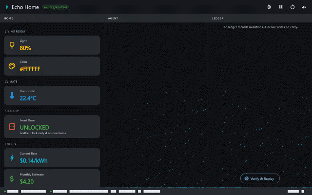

# cell_skin

```bash
dart run skills@ get cell_skin
```

The skill carries the workflow, the hard rules, the BRD elevator
matrix, and the generated decision matrix — the same matrix in two
formats: `lib/doc/api_chooser.dart` and
`skills/cell-skin/references/api_chooser.md`. The pin is
`cell_skin 1.0.0`.

The membrane between a Cell graph and the outside world — MCP-native,
audit-ready, replay-verifiable.

The core thesis: **the wire is a `Pulse<WireMessage>` stream, and the
membrane is four Cells composed from framework primitives.** Not one
non-Cell `SkinServer`; not one skin Cell; four Cells in a pipeline,
each doing one thing.

```text
Cell.ingress → Cell.asyncMap → target.apply → Cell.observe → Cell.observe
(inbound)      (router)          (the plug)     (egress)        (outbound)
```



**Echo Home — the live demo.** A scripted agent drives the real
four-cell membrane, the real `TestCell` gates (the door lock is
genuinely refused), the real hash-chained ledger, and a real
zero-divergence replay. Walkthrough: [DEMO_GUIDE.md](DEMO_GUIDE.md);
source: [example/](example/).

Every remote call lands in `Cell.apply` on the real target cell. Every
receipt that crosses the wire is the target's own receipt — the router
calls `target.apply`, never its own. Every rejection is a real
framework rejection. The ledger stays the single source of truth, and
the same four Cells serve MCP and REST without a second wire format.

## What `cell_skin` is and is not

| `cell_skin` is | `cell_skin` is not |
| :--- | :--- |
| A `Pulse<WireMessage>` codec + taxonomy | A JSON-RPC implementation (that is `dart_mcp`'s job) |
| Four Cells composed from `Cell.ingress` / `Cell.asyncMap` / `Cell.observe` | A new Cell subclass |
| A binding table from `(cellId, fnName)` to live Dart closures | Reflection over Dart functions |
| Three gates: exposure (router Cell), the optional `SkinAuthorizer` hook, + domain (target's `TestCell.action`) | A unified authorization language |
| A receipt-preserving courier | A parallel apply path |
| A REST binding sharing the same Cells as MCP | A second architecture |

The receipt-provenance rule is the design's load-bearing constraint:
the router Cell packages `WireRequest` into `ApplyCommand`, hands it to
`target.apply`, and carries the target's own receipt back in
`WireResponse`. `receipt.cell`, `receipt.function`, and
`receipt.ledgerSeq` stay accurate to the domain, not the transport.

## Quick start

```dart
import 'package:cell/cell.dart';
import 'package:cell_skin/cell_skin.dart';

Future<void> main() async {
  final thermostat = Cell.state<int>(initial: 22);
  final graph = (CellGraph.builder(graphId: 'demo')
        ..register('home.living.thermostat', thermostat.cell))
      .build();
  final ledger = await graph.bindLedger(
    store: InMemoryLedgerStore(genesisHash: Ledger.genesisHashOf(graph.id)),
  );

  final bindings = SkinBindingTable()
    ..register(SkinBinding.state(
      cellId: 'home.living.thermostat',
      functionName: 'setTarget',
      target: thermostat.cell,
      nextValue: (int target) => target,
      argumentSchema: const JsonSchema(
        type: 'object',
        properties: {
          'target': JsonSchema(type: 'integer', minimum: 16, maximum: 26),
        },
        required: ['target'],
      ),
    ));

  final membrane = await SkinMembrane.open(
    graph: graph,
    bindings: bindings,
    ledger: ledger,
    journal: RecordingJournal(),
    send: (_) {}, // your transport's writer (MCP reply, HTTP response, SSE)
  );

  final client = SkinClient(membrane: membrane);
  final outcome =
      await client.apply('home.living.thermostat', 'setTarget', positional: [19]);
  // outcome is the target's real ApplyOutcome<Object?>. With a bound
  // ledger the router opened the graph's ledger scope around this apply —
  // `graph.run` is not required for remote applies. Wrap several
  // in-process applies in `graph.run(...)` when they must share one
  // scope; the router will not open a second one.
}
```

For MCP or REST over a real socket, wrap the same membrane:

```dart
import 'package:cell_skin/cell_skin_rest.dart';

final adapter = await RestAdapter.bind(
  membrane: membrane,
  auth: const AllowAllSkinAuth(), // anonymous access is an explicit opt-in
); // POST /skin/apply, GET /skin/manifest, SSE observe/ledger, …
```

`cell_skin` does not implement MCP; the `McpAdapter` seam plus
`mcpToolSpecs(manifest)` is everything an SDK adapter (`dart_mcp`,
`mcp_dart`) needs — choosing the SDK stays a pubspec decision.

## Live demo — Echo Home

`example/` contains **Echo Home**, the runnable live demo: a polished
smart-home app where a scripted AI agent drives the real membrane, the
real `TestCell` gate on the door, the real hash-chained ledger, and the
real `ReplayEngine`.

```bash
cd example
flutter pub get
flutter run -d chrome   # or macos, linux, windows
```

No API keys, no network, runs offline in ~20 seconds. The scripted
agent discovers 6 tools, accepts `thermostat.setTarget(19)`, gets
**rejected** by the door's real `TestCell.action` (occupant home), and
batches two light changes through one `Cell.txApply` call. The ledger
records the mutations with their real apply receipts; the denial writes
no entry — that silence is the framework's too. "Verify & Replay" runs
the real `ReplayEngine` into a fresh graph: **0 divergences**.

The demo's Developer Mode (the bug icon) shows the four wire Cells and
their live pulse journals from the `cell_flutter` DevTools registry;
`DEMO_RECORDING=true` drives the 300-frame storyboard marker used to
produce the README GIF. Every piece of demo UI state is a cell bound
through `cell_flutter` (`CellBuilder` / `CellValueBuilder` /
`CellListener` / `CellListView`). See `example/README.md`.

## How it works

- The **inbound cell** (`Cell.ingress`) accepts transport pulses; its
  only logic is the wire-pulse integrity gate.
- The **router cell** (`Cell.asyncMap`, `concurrency: 1`) looks up the
  binding, validates the declared argument schema, checks the
  stateless cursor (`lastSeenSeq`) when the binding opts in, calls
  `target.apply`, and packages the target's real receipt into a
  `Pulse<WireResponse>`. Duplicate correlation ids replay the stored
  outcome instead of re-applying.
- The **egress cells** emit `skin.egress.<cellId>` pulses carrying
  `WireStateChange` — not a reply, so egress can never complete a
  pending request. With a bound ledger, egress is driven by
  `Ledger.tail`: the entry's own receipt pairs with the entry's own
  pulse payload. Without one, target observations are always
  `pendingReceipt` — a receipt is never fabricated.
- The **mux** (`Cell.synthesis`) fans in router responses, egress
  observations and the ledger tail (`skin.ledger.entry`).
- The **outbound cell** (`Cell.observe`) writes surviving pulses to the
  transport.

The two gates stay exactly as the plan specifies:

| Gate | Location | Rejection |
| :--- | :--- | :--- |
| **Exposure** | Router binding lookup (+ optional `SkinWhitelist`) | `WireError{code: 'unknown_tool'}` — no receipt produced |
| **Domain** | The target's `TestCell.action`, inside `target.apply` | `ApplyRejected` — the framework's real denial |

## Wire taxonomy

`WireMessage` is a sealed hierarchy: `WireRequest`, `WireResponse`,
`WireStateChange`, `WireNotification`, `WireManifestRequest`,
`WireManifestResponse`, `WireLedgerEntry`, `WireError`. Pulse types
follow the plan's naming (`mcp.tools.call`,
`mcp.tools.result.{accepted,rejected,staged}`, `rest.apply.*`,
`skin.manifest.*`, `skin.ledger.entry`, `skin.egress.<cellId>`,
`skin.error.transport`). The pulse codec is the framework's own
`PulseCodec` — no new envelope codec.

## Honest deviations from the plan

- `WireStateChange` is the egress variant: a state observation is not
  a reply, so it carries no correlation id. Its `pendingReceipt` flag
  marks "no ledger entry for this change exists" — a receipt is never
  fabricated and never borrowed from an earlier change.
- `WireError` is a separate `WireMessage` variant for exposure and
  cursor rejections: an error with no receipt must not masquerade as a
  `WireResponse`.
- The router is materialised as `Cell.asyncMap` with `concurrency: 1`;
  the synchronous `Cell.hub` variant is an optimisation, not a second
  dispatch path.
- The response pulse's correlation travels inside `WireResponse`
  (the public `Pulse` factory has no parent-chain constructor);
  `correlationId` is the transport-side match.
- `RemoteCellClient` is a cell-shaped handle (`call` / `observe`), not
  a full `implements Cell` facade — that surface mirror is the
  documented next hardening.
- The concrete `DartMcpAdapter` ships when the SDK dependency is
  promoted into this package's pubspec; the `McpAdapter` seam is live
  today.

## Testing

```bash
dart test
```

The suite covers wire round-trips, schema translation, the binding
table, receipt provenance (accepted / rejected / unknown tool /
manifest), egress receipt joins, the exposure gate, stateless cursors,
the in-process client, the REST adapter over real sockets, and the
in-process acceptance test: membrane-driven applies replay into a fresh
graph with **zero divergences**. The generated inventory lives in
[TEST_VERIFICATION.md](TEST_VERIFICATION.md).

## Documentation

- [ARCHITECTURE-Skin.md](ARCHITECTURE-Skin.md) — the membrane design: the
  four-cell pipeline, receipt provenance, the two gates, correlation
  and idempotency, the adapter security posture.
- [FEATURES-Skin.md](FEATURES-Skin.md) — the feature catalog: wire vocabulary,
  bindings, cursors, manifest, REST, MCP seam, clients, security SPI.
- [DEMO_GUIDE.md](DEMO_GUIDE.md) — the Echo Home live demo guide.
- [TEST_VERIFICATION.md](TEST_VERIFICATION.md) — generated test report
  (regenerate with `python tool/generate_test_verification.py
  --run-tests`).
- [CONTRIBUTING-AI-DOC.md](CONTRIBUTING-AI-DOC.md) — the `### AI Agent
  Guide` doc-comment convention.
- **HowTo guides** (`guide/`): [HowTo-Start](guide/HowTo-Start.md),
  [Bindings](guide/HowTo-Bindings.md),
  [Whitelist](guide/HowTo-Whitelist.md),
  [Membrane](guide/HowTo-Membrane.md),
  [WireMessages](guide/HowTo-WireMessages.md),
  [Egress](guide/HowTo-Egress.md), [Cursors](guide/HowTo-Cursors.md),
  [Idempotency](guide/HowTo-Idempotency.md),
  [RestAdapter](guide/HowTo-RestAdapter.md),
  [McpSeam](guide/HowTo-McpSeam.md), [Auth](guide/HowTo-Auth.md),
  [Testing](guide/HowTo-Testing.md),
  [Recording](guide/HowTo-Recording.md).
- API docs — `dart doc .` generates `doc/api` (Topics + Libraries).
  Every HowTo guide, plus Features / Architecture / Demo / Test
  Verification, is a Topics category with annotated API elements.
  Key public APIs carry the Cell framework's standard sections
  (`### When to use`, `### How it works`, `### Non-obvious`,
  `### See also`).
- Skill — `skills/cell-skin/` is the official package skill for AI
  agents; its decision matrix is generated from the AI Agent Guide
  blocks (`dart run tool/generate_api_chooser.dart`) and guarded by
  `test/api_chooser_up_to_date_test.dart`.


